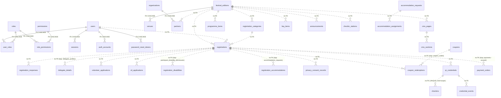

# Database Architecture, Registration Numbering & Transaction Integrity Inventory

**Project:** Purple Festival Gujarat 2027 (`d:\purplefestgujarat`)  
**Audit Mode:** Strict read-only forensic inspection (zero schema changes, zero destructive SQL)  
**Primary Sources:** `database/schema.sql` (956 lines, 57 tables), `database/seed.sql` (200 lines), `includes/database.php` (1,011 lines), `includes/qr-service.php`, `api/registrations/index.php`

---

## 1. Schema Baseline & Global Structural Findings

| Metric | Verified Value | Evidence |
|---|---|---|
| Total tables in `database/schema.sql` | **57** | `database/schema.sql:13-954` |
| Storage engine & charset | `InnoDB`, `utf8mb4`, `utf8mb4_unicode_ci` | All 57 `CREATE TABLE` statements |
| Foreign key constraints (`FOREIGN KEY`) | **9 total** across 57 tables (**48 tables have ZERO FKs**) | Only `role_permissions` (2), `user_roles` (2), `auth_accounts` (1), `password_reset_tokens` (1), `sessions` (1), `venues` (1), `partners` (1) |
| `ENUM` / `CHECK` constraints | **0 `ENUM`**, **0 `CHECK`** | All statuses/types/amounts are unconstrained `VARCHAR`/`INT` |
| Exact-duplicate parallel table pairs | **6 pairs** (+ 1 overlapping pair `auth_accounts`/`password_reset_tokens`) | See Section 3 |
| Completely unused tables (0 runtime PHP callers) | **8 tables** (+ `notification_jobs` referenced only in dead code) | See Section 4 |
| Write-only / seed-only tables (never read at runtime) | **8 tables** | See Section 4 |
| Deployed Staging DB Parity | **BROKEN / UNSEEDED EDITION** — Staging `GET /api/registrations` returns `HTTP 404 {"error":"No active festival edition configured."}` and `/apply` falls back to 4 hardcoded categories (`id="ATTENDEE"`) | Live read-only staging probe (`task-1406`) |
| Local MySQL / SQLite test DB | Local MySQL not installed; `database/pfg27.sqlite` does not exist on disk | Local tool probe (`where mysql` -> NOT_FOUND) |

> **Warning on Schema vs. Deployed DB:** `database/schema.sql` cannot be assumed to match the live staging MySQL database (`tstpllmy_pfg27`). Staging returned `200 {"user":null}` on `/api/auth/me` (confirming `sessions`/`users` tables exist) but `404` on `/api/registrations` (confirming `festival_editions` has no active `gujarat-2027` row, likely due to partial seeding or the `ensureDatabaseInitialized()` early-return trap at `includes/database.php:215-221`).

---

## 2. Entity-Relationship Diagram (Core Logical Relationships)

> Note: Dashed lines denote **logical** relationships unenforced by database `FOREIGN KEY` constraints (48 of 57 tables lack FKs).

---

## 3. Complete 57-Table Inventory

| # | Table (`schema.sql` lines) | Purpose | PK / Unique / Key Indexes | FKs | Status / Usage | Readers / Writers (PHP) | Sensitive Data |
|---|---|---|---|---|---|---|---|
| 1 | `roles` (`13-21`) | RBAC role catalog (`SUPERADMIN`, `ADMIN`, `RGST`, `PARTICIPANT`) | PK `id`; UQ `code` | None | Active | R: `auth.php`, `users.php`, `signup.php`, `bootstrap-superadmin.php`; W: `database.php`, `signup.php` | No |
| 2 | `permissions` (`23-30`) | Permission catalog (20 codes) | PK `id`; UQ `code` | None | **Seed-only (never read at runtime)** | W: `database.php` | No |
| 3 | `role_permissions` (`32-41`) | Role-to-permission join | PK `id`; UQ `(role_id, permission_id)` | `role_id`, `permission_id` CASCADE | **Seed-only (never read; omitted from `seed.sql`!)** | W: `database.php` | No |
| 4 | `users` (`43-65`) | Staff & participant identity records | PK `id`; UQ `username`, `email` | None | Active (duplicate `mfa_secret` & `mfa_secret_encrypted`) | R/W: `auth.php`, `login.php`, `signup.php`, `mfa.php`, `password-reset.php`, `profile.php`, `registrations/index.php`, `admin/users.php`, `bootstrap-superadmin.php` | **YES** (PII, bcrypt hash, **plaintext TOTP secrets**) |
| 5 | `user_roles` (`67-79`) | User-to-role + `custom_permissions` JSON | PK `id`; UQ `(user_id, role_id)` | `user_id`, `role_id` CASCADE | Active | R: `auth.php`, `admin/users.php`; W: `admin/users.php`, `signup.php`, `registrations/index.php`, `bootstrap-superadmin.php` | No |
| 6 | `auth_accounts` (`81-94`) | Pending MFA setup secrets & reset tokens | PK `id`; IDX `user_id`, `(provider, token_hash)` | `user_id` CASCADE | Active (overlaps `password_reset_tokens`) | R/W: `api/auth/mfa.php`, `api/auth/password-reset.php` | **YES** (**plaintext MFA setup secret** in `token_hash`) |
| 7 | `password_reset_tokens` (`96-108`) | Password reset HMAC tokens | PK `id`; UQ `token_hash`; IDX `user_id` | `user_id` CASCADE | Orphaned (API has no UI; `used_at` never set) | R/W: `api/auth/password-reset.php` | **YES** (token hashes, emails) |
| 8 | `sessions` (`110-124`) | Active HMAC-hashed user sessions | PK `id`; UQ `token_hash`; IDX `user_id` | `user_id` CASCADE | Active | R/W: `includes/auth.php`, `api/auth/mfa.php`, `api/auth/password-reset.php`, `api/admin/users.php` | **YES** (session hashes, IP, UA) |
| 9 | `festival_editions` (`130-147`) | Edition metadata & `attendance_policy` | PK `id`; UQ `slug` | None | Active (missing row on staging -> 404!) | R: `apply/index.php`, `api/registrations/index.php`, `api/admin/cms.php`, `qr-service.php`; W: `database.php` | No |
| 10 | `venues` (`149-162`) | Venue accessibility & confirmation status | PK `id`; IDX `edition_id` | `edition_id` CASCADE | Read-only public (`map_url` unused) | R: `accessibility.php`; W: `database.php` | No |
| 11 | `festival_sessions` (`164-180`) | Detailed session slots | PK `id`; IDX `edition_id` | None | **COMPLETELY UNUSED (0 PHP refs)** | None | No |
| 12 | `checkin_stations` (`182-192`) | Check-in gate definitions | PK `id`; IDX `edition_id` | None | Active (read by RGST; unvalidated on confirm) | R: `rgst/index.php`; W: `database.php` | No |
| 13 | `programme_items` (`194-212`) | 3-day schedule items | PK `id`; IDX `(edition_id, day_number, display_order)` | None | Active (`session_id` & `speakers` unused on FE) | R: `index.php`, `programme.php`, `api/admin/cms.php`; W: `api/admin/cms.php`, `database.php` | No |
| 14 | `organizations` (`214-224`) | Partner organization profiles | PK `id` | None | Active (orphaned on partner DELETE) | R: `index.php`, `api/admin/cms.php`; W: `api/admin/cms.php`, `database.php` | No |
| 15 | `partners` (`226-239`) | Partner tier, consent & status | PK `id`; IDX `(edition_id, display_order)` | `organization_id` CASCADE | Active (`index.php` ignores `consent_verified`) | R: `index.php`, `api/admin/cms.php`; W: `api/admin/cms.php`, `database.php` | No |
| 16 | `disability_categories` (`245-255`) | 21 RPwD Act 2016 disabilities | PK `id`; UQ `code` | None | Active | R: `accessibility.php`, `apply/index.php`, `api/registrations/index.php`, `api/admin/registrations.php`; W: `database.php` | No |
| 17 | `accommodation_types` (`257-266`) | 13 accessibility accommodation types | PK `id`; UQ `code` | None | Active | R: `accessibility.php`, `apply/index.php`, `api/registrations/index.php`, `api/account/accommodations.php`, `api/admin/accommodations.php`, `dashboard/index.php`; W: `database.php` | No |
| 18 | `registration_categories` (`268-285`) | 8 categories, fees, approval/payment flags | PK `id`; UQ `(edition_id, code)` | None | Active (`confirmation_message` unused) | R: `apply/index.php`, `api/registrations/index.php`, `api/coupons/validate.php`, `api/admin/cms.php`, `dashboard/*`, `qr-service.php`; W: `api/admin/cms.php`, `database.php` | No |
| 19 | `registration_form_versions` (`287-298`) | Form schema versioning | PK `id`; UQ `(edition_id, category_code, version_number)` | None | **COMPLETELY UNUSED (0 PHP refs)** | None | No |
| 20 | `registrations` (`300-336`) | Core participant registrations | PK `id`; UQ `registration_code`; IDX `user_id`, `(edition_id, category_code)`, `status` | None (missing 5 FKs + missing `(user_id, edition_id, category_code)` index) | Active | R/W: `api/registrations/index.php`, `api/admin/registrations.php`; R: `overview.php`, `accommodations.php`, `qr-service.php`, `checkins/*`, `dashboard/*`, `account/accommodations.php` | **YES** (PII, `is_person_with_disability`) |
| 21 | `registration_responses` (`338-347`) | Raw submitted JSON payload backup | PK `id`; IDX `registration_id` | None | **Write-only (never read)** | W: `api/registrations/index.php` | **YES** (raw PII + disability disclosures) |
| 22 | `participant_affiliations` (`349-360`) | Normalized affiliation history | PK `id`; IDX `user_id` | None | **COMPLETELY UNUSED (0 PHP refs)** | None | No |
| 23 | `registration_disabilities` (`362-373`) | RPwD disclosures (Duplicate #1) | PK `id`; IDX `registration_id` | None | **DUPLICATE of #24** (written, rarely read) | W: `api/registrations/index.php`; R (fallback): `api/admin/registrations.php` | **HIGHLY SENSITIVE** (unencrypted health/disability data) |
| 24 | `participant_disability_disclosures` (`375-386`) | RPwD disclosures (Duplicate #2) | PK `id`; IDX `registration_id` | None | **DUPLICATE of #23** | W: `api/registrations/index.php`; R: `api/admin/registrations.php` (never rendered in UI) | **HIGHLY SENSITIVE** (unencrypted health/disability data) |
| 25 | `registration_accommodations` (`388-404`) | Accommodation requests (Duplicate #1) | PK `id`; IDX `registration_id` | None | **DUPLICATE of #26 — LIVE DUPLICATION BUG** (different UUIDs written at registration!) | R/W: `api/registrations/index.php`, `api/account/accommodations.php`, `api/admin/accommodations.php`; R: `overview.php`, `admin/registrations.php`, `dashboard/index.php` | **SENSITIVE** (accessibility needs) |
| 26 | `accommodation_requests` (`406-422`) | Accommodation requests (Duplicate #2) | PK `id`; IDX `registration_id` | None | **DUPLICATE of #25 — LIVE DUPLICATION BUG** | Same as #25 | **SENSITIVE** (accessibility needs) |
| 27 | `accommodation_assignments` (`424-434`) | Coordinator assignment & notes | PK `id`; IDX `request_id` | None | Active | R/W: `api/admin/accommodations.php` | **SENSITIVE** (coordinator notes) |
| 28 | `volunteer_applications` (`436-463`) | Volunteer details & duty allocation | PK `id`; IDX `registration_id` (not UQ!) | None | Active (`document_url` unused) | W: `api/registrations/index.php`, `api/admin/registrations.php`; R: `admin/registrations.php`, `dashboard/*`, `registrations/index.php` | **YES** (age, emergency contact, CRR) |
| 29 | `sli_applications` (`465-490`) | SLI qualifications & session assignments | PK `id`; IDX `registration_id` (not UQ!) | None | Active (`document_url` unused) | W: `api/registrations/index.php`, `api/admin/registrations.php`; R: `admin/registrations.php`, `dashboard/*`, `registrations/index.php` | **YES** (CRR, honorarium notes) |
| 30 | `delegate_profiles` (`492-512`) | Delegate profile (Duplicate #1) | PK `id`; IDX `registration_id` | None | **DUPLICATE of #31** (never read when #31 exists) | W: `api/registrations/index.php`; R (fallback): `registrations/index.php`, `admin/registrations.php` | **YES** (age, emergency contact, guardian) |
| 31 | `delegate_details` (`514-534`) | Delegate profile (Duplicate #2) | PK `id`; IDX `registration_id` | None | **DUPLICATE of #30** (`dietary_requirements`, `arrival_date`, `departure_date` unused) | W: `api/registrations/index.php`; R: `registrations/index.php`, `admin/registrations.php` (dropped by Admin modal) | **YES** (age, emergency contact, guardian) |
| 32 | `qr_credentials` (`540-560`) | QR pass hashes & status (`ACTIVE`/`REVOKED`) | PK `id`; UQ `credential_code`, `token_hash`; IDX `registration_id` | None | Active (`raw_token` & `issued_by` never written) | R/W: `includes/qr-service.php`; R: `api/qr/pass.php`, `api/admin/registrations.php`, `dashboard/*` | **YES** (bearer token hashes) |
| 33 | `attendance_entitlements` (`562-572`) | Entitlement quotas per credential | PK `id`; UQ `(credential_id, scope_key)` | None | **COMPLETELY UNUSED (0 PHP refs)** | None | No |
| 34 | `checkins` (`574-593`) | Confirmed check-ins | PK `id`; UQ `(credential_id, entitlement_scope)`; IDX `registration_id`, `operator_user_id` | None | Active (**BUG**: UQ keyed on `credential_id` not `registration_id`!) | W: `qr-service.php`; R: `checkins/index.php`, `rgst/index.php`, `overview.php`, `admin/registrations.php`, `dashboard/index.php` | Low (attendance timestamps) |
| 35 | `credential_events` (`595-604`) | QR scan/issue/revoke/duplicate audit | PK `id`; IDX `credential_id` | None | **Write-only (never read)** | W: `includes/qr-service.php` | Low |
| 36 | `coupons` (`610-629`) | Discount/waiver coupons (Duplicate #1) | PK `id`; UQ `code` | None | **DUPLICATE of #37** | R/W: `api/admin/coupons.php`, `api/registrations/index.php`; R: `api/coupons/validate.php` | No |
| 37 | `coupon_codes` (`631-650`) | Discount/waiver coupons (Duplicate #2) | PK `id`; UQ `code` | None | **DUPLICATE of #36** | Same as #36 | No |
| 38 | `coupon_redemptions` (`652-661`) | Per-user coupon redemption log | PK `id`; IDX `coupon_id` | None | Active (missing UQ & `(coupon_id, user_id)` idx) | W: `api/registrations/index.php`; R: `api/coupons/validate.php`, `api/admin/coupons.php` | No |
| 39 | `payments` (`663-681`) | Payment orders (Duplicate #1) | PK `id`; IDX `registration_id` | None | **Read-only empty shell (0 writers!)** | R: `api/admin/overview.php`, `api/admin/registrations.php` | Financial (empty) |
| 40 | `payment_orders` (`683-701`) | Payment orders (Duplicate #2) | PK `id`; IDX `registration_id` | None | **Read-only empty shell (0 writers!)** | R: `api/admin/overview.php`, `api/admin/registrations.php` | Financial (empty) |
| 41 | `payment_transactions` (`703-715`) | Gateway verified transactions | PK `id`; UQ `provider_payment_id` | None | **COMPLETELY UNUSED (0 PHP refs)** | None | Financial (empty) |
| 42 | `refunds` (`717-727`) | Payment refunds | PK `id` | None | **COMPLETELY UNUSED (0 PHP refs)** | None | Financial (empty) |
| 43 | `cms_pages` (`733-745`) | CMS pages (`home`) | PK `id`; UQ `(edition_id, slug)` | None | Active | R: `index.php`, `api/admin/cms.php`; W: `database.php` | No |
| 44 | `cms_sections` (`747-761`) | CMS content blocks | PK `id`; UQ `(page_id, section_key)` | None | Active (`hero.title`/`subtitle` ignored on FE) | R: `index.php`, `api/admin/cms.php`; W: `api/admin/cms.php`, `database.php` | No |
| 45 | `faq_items` (`763-774`) | Public FAQs | PK `id`; IDX `(edition_id, display_order)` | None | Active | R: `index.php`, `api/admin/cms.php`; W: `api/admin/cms.php`, `database.php` | No |
| 46 | `media_assets` (`776-790`) | Gallery media URLs & alt text | PK `id` (missing `category` idx) | None | Active (`size_bytes` unused; `index.php` lacks `ORDER BY`) | R: `index.php`, `api/admin/cms.php`; W: `api/admin/cms.php`, `database.php` | No |
| 47 | `content_revisions` (`792-802`) | CMS revision snapshots | PK `id` (missing `(entity_type, entity_id)` idx) | None | Active (returned by CMS GET; unused in UI) | R/W: `api/admin/cms.php` | No |
| 48 | `announcements` (`804-816`) | Festival announcements | PK `id` | None | **Admin-only dead feature (NEVER rendered publicly)** | R/W: `api/admin/cms.php` | No |
| 49 | `notification_templates` (`822-832`) | Email templates (3 seeded) | PK `id`; UQ `code` | None | Partially used (`mailer.php` ignores it; `PASSWORD_RESET` missing) | R: `database.php:queueNotification()`; W: `database.php` | No |
| 50 | `notification_queue` (`834-853`) | Email audit/queue log (Duplicate #1) | PK `id`; IDX `status` | None | **Write-only (NO worker drains `QUEUED`! Primary INSERT fails due to schema drift!)** | W: `includes/mailer.php`, `includes/database.php:queueNotification()` | **YES (CRITICAL: stores plaintext `rawToken` & `resetUrl` in `payload`!)** |
| 51 | `notification_jobs` (`855-874`) | Email queue (Duplicate #2) | PK `id`; IDX `status` | None | **DEAD (only in uncalled `pfgQueueNotificationCompat`)** | None live | No |
| 52 | `notification_delivery_logs` (`876-885`) | Provider message IDs & webhooks | PK `id` | None | **COMPLETELY UNUSED (0 PHP refs)** | None | No |
| 53 | `audit_logs` (`891-905`) | Security & admin audit trail | PK `id`; IDX `actor_user_id`, `action`, `created_at` | None | Active (API truncated at `LIMIT 500`!) | W: `includes/auth.php`, `api/registrations/index.php`; R: `api/admin/audit-logs.php` | Moderate (IP, UA, emails in metadata) |
| 54 | `admin_actions` (`907-917`) | Before/after admin state snapshots | PK `id` | None | **Write-only (never read anywhere)** | W: `api/admin/registrations.php`, `accommodations.php`, `users.php` | Moderate |
| 55 | `system_settings` (`919-928`) | Key-value settings (`payments.enabled`, `sli.require_crr`) | PK `id`; UQ `key` | None | **Seed-only (never read or updated at runtime!)** | W: `database.php` | No |
| 56 | `privacy_consent_records` (`930-942`) | DPDP/harassment/media consents | PK `id`; IDX `registration_id` | None | **Write-only (never read; `withdrawn_at` never set)** | W: `api/registrations/index.php` | **YES** (consent audit + IP) |
| 57 | `data_retention_requests` (`944-954`) | DPDP deletion/export requests | PK `id` | None | **COMPLETELY UNUSED (0 PHP refs)** | None | **YES** (unused) |

---

## 4. Schema Drift, Seed Drift & Connection Layer Hazards

1. **Column-Level Schema Drift (`includes/mailer.php:120-122` vs `database/schema.sql:834-853`):**
   - `includes/mailer.php` attempts `INSERT INTO notification_queue (..., provider, provider_message_id, sent_at, ...)` — neither `provider` nor `provider_message_id` exists in `notification_queue`. Every email send triggers a caught `SQLSTATE 42S22` exception and falls back to L146-164, which drops `sent_at`, `body_html`, `body_text`, and `last_error`.
2. **Duplicate Table Divergence (`registration_accommodations` vs `accommodation_requests`):**
   - `api/registrations/index.php:1038` generates a **new `uuid4()` inside the dual-table loop**, giving identical records two different UUIDs. Downstream deduplication-by-`id` in `dashboard/index.php:125-148`, `api/account/accommodations.php:62-83`, and `api/admin/registrations.php:320-346` fails -> **every registration-time accommodation request renders TWICE**.
3. **Seed Drift (`database/seed.sql` vs `includes/database.php:seedDatabase()`):**
   - `database/seed.sql` omits `role_permissions` completely and seeds only **5 partners** (with `MSU Baroda.logo_url = NULL`), whereas `includes/database.php:495-712` seeds **11 brochure partners** and all `role_permissions`.
   - `ensureDatabaseInitialized()` (`includes/database.php:215-221`) exits early if `SELECT COUNT(*) FROM roles > 0`, so importing `schema.sql` + `seed.sql` permanently prevents `seedDatabase()` from syncing the 11 partners or `role_permissions`.
4. **Per-Request DDL Execution (`includes/database.php:187-221`):**
   - On **every HTTP request**, `getDb()` executes `SELECT COUNT(*) FROM roles` and `ensureUsersUsernameColumn()` (`ALTER TABLE users ADD COLUMN username ...` + `CREATE UNIQUE INDEX ...`), acquiring MySQL metadata locks and risking implicit transaction commits.
5. **PDO & SQLite Fallback Risks (`includes/database.php:78-167`):**
   - `PDO::ATTR_EMULATE_PREPARES => true` is enabled globally (because several admin queries reuse named parameters like `:q` and `:now`).
   - If `DB_NAME`/`DB_USER` env vars fail to load, production **silently falls back** to `database/pfg27.sqlite`, where `convertMysqlDdlToSqlite()` (`L165-167`) strips all `FOREIGN KEY` constraints and `CURRENT_TIMESTAMP` is UTC vs PHP's IST `+05:30` (5h30m skew).

---

## 5. Registration ID & Credential Numbering Forensic Audit (Section 27)

- **Responsible Function:** `generateUniqueRegistrationCode(PDO $pdo, int $maxAttempts = 10): string` (`includes/qr-service.php:228-247`).
- **Format:** `PFG-2027-` + 6-digit zero-padded sequence (`%06d`) + `-` + 4 uppercase hex characters (`strtoupper(bin2hex(random_bytes(2)))`), e.g. `PFG-2027-000100-A3F9`.
- **Execution Point:** Called at `api/registrations/index.php:725` — **BEFORE `$pdo->beginTransaction()` at line 730**.
- **Database Locks:** **NONE** (`SELECT COUNT(*) FROM registrations` uses an unlocked snapshot read).
- **Will Existing Records Be Overwritten?** **NO.** `registrations.registration_code` has `UNIQUE KEY registrations_code_unique` (`database/schema.sql:331`) and `api/registrations/index.php:734` uses `INSERT INTO registrations` (never `UPDATE` or `ON DUPLICATE KEY UPDATE`). Two participants cannot overwrite the same row.
- **Exact Concurrency & Sequence Integrity Defects (Mathematically & Statistically Verified — Runtime Concurrency Test `NOT RUN` due to missing local PHP/MySQL):**
  1. **Duplicate Numeric Sequence Prefixes Under Concurrency:** If 99 rows exist and Users A & B submit simultaneously, both read `COUNT(*) = 99`, compute `$seq = 100`, and receive `PFG-2027-000100-XXXX` and `PFG-2027-000100-YYYY`. The numeric component `000100` is **NOT independently unique** — neither user gets `000101`, and the next registrant gets `000102` (skipping `000101`).
  2. **Unhandled `PDOException` (HTTP 500) on Suffix Collision:** Although `generateUniqueRegistrationCode()` loops up to 10 times checking `SELECT id FROM registrations WHERE registration_code = :code`, that check occurs before `INSERT`. If two concurrent requests read the same `COUNT(*)` AND draw the same 16-bit hex suffix (probability $1/65{,}536$ per concurrent pair), both pass the pre-check, one commits, and the second hits `SQLSTATE 23000` (`1062 Duplicate entry`) with **no retry loop on `INSERT`** -> unhandled `HTTP 500`!
  3. **Number Reuse on Hard Deletes:** Because it uses `COUNT(*) + 1` rather than an `AUTO_INCREMENT` sequence table, hard-deleting rows reduces `COUNT(*)` and causes subsequent registrations to reuse lower sequence numbers. (Soft deletes via `deleted_at` are still counted.)
  4. **Credential Reissuance Independence:** Reissuing a QR pass appends `-R2`, `-R3` to `qr_credentials.credential_code` (`includes/qr-service.php:311-314`) and does **not** alter `registrations.registration_code`. Registration identifiers are logically independent of QR credentials.

---

## 6. Transaction Boundaries & Atomicity Audit (Section 28)

| Operation | Transaction Used? | Exact Boundary & Atomicity / Idempotency Failures |
|---|---|---|
| **Participant Registration** (`api/registrations/index.php`) | **PARTIAL** (`L730-1101`) | **FAIL #1 (Orphaned Users):** `INSERT INTO users` & `user_roles` run at `L554-601` **BEFORE `beginTransaction()`**. If duplicate check (`409`), coupon error (`400`), or transaction rollback occurs, the `users` row remains orphaned. **FAIL #2 (TOCTOU Duplicates):** Duplicate registration check (`L604-626`) runs outside transaction with no DB `UNIQUE(user_id, edition_id, category_code)` -> concurrent double-clicks create 2 active registrations + 2 QR passes. **FAIL #3 (Coupon Over-Redemption):** `used_count < max_uses` and `max_uses_per_user` checked outside transaction without `FOR UPDATE` + unguarded `UPDATE used_count = used_count + 1` -> unlimited concurrent bypass. **FAIL #4 (Email Failure):** Runs post-commit (`L1109-1129`). Registration stays committed cleanly, but API falsely reports `qrEmailed: true` and has no retry worker. |
| **Account Signup** (`api/auth/signup.php`) | **NONE** | Inserts `users`, `roles`, `user_roles`, `sessions` non-atomically (`L52-87`). Concurrent signups hit `users_email_unique` -> HTTP 500. |
| **Admin Approval, Duty & QR Reissue** (`api/admin/registrations.php`) | **NONE** | `UPDATE registrations` (`L710`) commits **before** permission checks (`L859, 869`) and before `issueCredentialForRegistration()` (`L873, 895`). Concurrent approvals/reissues can collide on `-R{N}` or leave **2 `ACTIVE` credentials simultaneously** (`qr-service.php:300-362`). |
| **Check-In Confirmation** (`includes/qr-service.php:789-907`) | **YES** (good) | `INSERT INTO checkins` wrapped in transaction with `UNIQUE(credential_id, entitlement_scope)` returning `409`. **Gaps:** eligibility (`status === 'ACTIVE'`) checked outside transaction; reissued `credential_id` bypasses same-day uniqueness; arbitrary `scopeOverride` bypasses uniqueness. |
| **Accommodation Request** (`api/account/accommodations.php:172-224`) | **NONE** | Dual-writes `accommodation_requests` then `registration_accommodations` in silent `try/catch`; tables can drift. |
| **CMS Partner Delete** (`api/admin/cms.php:888`) | **NONE** | Deletes `partners` row only, leaving orphaned `organizations` row forever. |
| **Coupons Admin Create/Update** (`api/admin/coupons.php:142-264`) | **NONE** | Dual-writes inside empty `catch (Throwable $e) {}` -> returns `201`/`200` even if both writes fail! |
| **Account Deletion / Registration Cancellation** | **NOT IMPLEMENTED** | Zero `DELETE` endpoints exist for users or registrations; no cascade cleanup workflow exists. |

