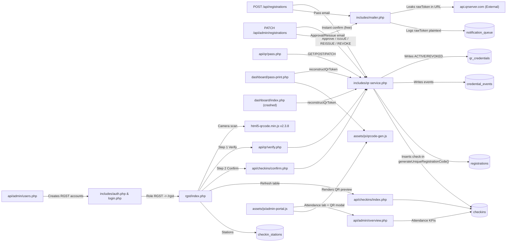

# QR Credential & Registration Desk (RGST) Dependency & Decommissioning Analysis

**Project:** Purple Festival Gujarat 2027 (`d:\purplefestgujarat`)  
**Audit Scope:** Part G (Sections 23, 24, 25) & Part M (Section 38 — Report 14)  
**Policy:** Strict read-only analysis. Zero credentials, records, check-ins, or tables were modified or deleted.

---

## 1. QR Credential Lifecycle & Cryptographic Integrity Summary

1. **Token Format (`includes/qr-service.php:50-74`):** `PFG27.<nonce>.<sig>` (55 chars, zero PII embedded).
   - `nonce`: 24 bytes base64url (32 chars). Deterministically derived via `HMAC-SHA256('pfg27-qr-nonce:' . $credentialId . ':' . $finalCode, QR_SIGNING_SECRET)` when `$seed` is passed (always passed during issuance at L317).
   - `sig`: 16 base64url chars (96 bits) of `HMAC-SHA256($nonce, QR_SIGNING_SECRET)`.
   - Verified in constant time via `hash_equals()` (`L98`).
2. **The "Hash-Only Storage" Contradiction (CRITICAL):**
   - While `qr_credentials.raw_token` is left `NULL` and `qr_credentials.token_hash` stores `HMAC-SHA256($rawToken, QR_SIGNING_SECRET)`, **the system is NOT truly hash-only for two reasons**:
     1. `reconstructQrTokenForCredential()` (`includes/qr-service.php:108-121`) deterministically recomputes the exact raw bearer token from `qr_credentials(id, credential_code)` + `QR_SIGNING_SECRET` (falling back silently to unsigned `$credentialCode` if secret rotates!).
     2. `includes/mailer.php:272` writes `'rawToken' => $rawToken` verbatim in plaintext into `notification_queue.payload` JSON!
3. **External QR Image Service Privacy Exposure (`api.qrserver.com`):**
   - `includes/mailer.php:196-198,223,254` embeds `">`.
   - Every recipient email transmits the live signed bearer token in an unencrypted GET URL query string to a third-party server, exposing it in third-party access logs, email image proxies (Gmail/Apple MPP), and browser history.
   - Possession of the token is sufficient to pass `POST /api/qr/verify.php` as a bearer credential (no secondary identity challenge exists at the desk beyond visual name display).
   - **Self-Hosted Alternative Already Exists on Frontend ONLY:** `assets/js/qrcode-gen.js` (723 lines, zero external deps, ISO 18004 Byte-mode ECC M) works in browsers; **no real server-side PHP QR generator exists** (`generateQrSvgDataUrl()` at `qr-service.php:129-144` is a fake placeholder SVG).
4. **RGST Operational Defects:**
   - Default scope sends literal `"GENERAL_ENTRY"` (`rgst/index.php:159,525-532`) instead of IST date, breaking `ONCE_PER_DAY` on Day 2 & Day 3.
   - Manual `registration_code` lookup (`qr-service.php:567-588`) matches old `REVOKED` `credential_code` before finding `-R2`, falsely blocking reissued participants.
   - Reissuing a credential creates a new `credential_id`, bypassing `UNIQUE(credential_id, entitlement_scope)` (`schema.sql:590`) and permitting a 2nd same-day check-in.
   - HTTP staging blocks `getUserMedia()` camera scanning (`html5-qrcode` v2.3.8); `stopCamera()` throws null `TypeError` before `.clear()`.
   - Zero credential expiry, zero offline verification, zero undo/override, zero zone/session check-ins.
   - **Data Minimization:** `api/qr/verify.php` (17 fields) and `api/checkins/confirm.php` (13 fields) properly strip disability, medical, accommodation, email, and phone at the backend — **1 caveat:** `REVOKED` message appends `revocation_reason`, which defaults to admin `reviewNotes` (`api/admin/registrations.php:848`).
   - **Downstream Impact of Check-Ins:** Check-ins feed **only** `/admin` Overview & Attendance analytics (`api/admin/overview.php`, `api/checkins/index.php`) and `dashboard/index.php` count badge. They do **NOT** trigger volunteer duty completion, SLI honorarium, participant status changes, or certificates.

---

## 2. QR & RGST Dependency Graph

> **CRITICAL COUPLING ALERT:** `generateUniqueRegistrationCode()` lives inside `includes/qr-service.php:228-247` even though registration IDs (`PFG-2027-XXXXXX-XXXX`) are independent of QR passes! Deleting `includes/qr-service.php` blindly would break `POST /api/registrations`!

---

## 3. Component-by-Component Decommissioning Classification Matrix

| Component | File(s) / Table(s) | Current Purpose | Dependencies | Recommended Future Treatment | Risk |
|---|---|---|---|---|---|
| **Registration Code Generator** | `includes/qr-service.php:228-247` (`generateUniqueRegistrationCode`) | Generates unique `PFG-2027-*` participant IDs | Called by `api/registrations/index.php:725` | **MODIFY / RETAIN** (extract into dedicated `includes/registration-id.php` using atomic DB sequence) | **HIGH** if accidentally deleted with QR service |
| **QR Token Crypto & Issuance Service** | `includes/qr-service.php:1-227, 259-911` | HMAC token gen, hash, reconstruct, issue/revoke, verify, confirm check-in | `api/registrations`, `api/admin/registrations`, `api/qr/*`, `api/checkins/*`, `dashboard/*` | **DISCONNECT / DEPRECATE** (split out registration ID helper first) | Medium — multiple callers require clean decoupling |
| **Live Camera Scanner Library** | `assets/js/html5-qrcode.min.js` (375 KB) | Browser camera QR decoding | Used ONLY by `rgst/index.php:455` | **POTENTIALLY REMOVE** if live QR scanning is retired | Low (isolated to `/rgst`) |
| **Registration Desk Portal** | `rgst/index.php`, `.htaccess:46` | Gate check-in UI (camera/USB/manual) | `api/qr/verify.php`, `api/checkins/*`, `checkin_stations`, `RGST` role | **DISCONNECT / DEPRECATE** (or **REQUIRES DECISION** if manual desk check-in without QR is desired) | Medium — remove sidebar link in `admin/index.php:108` & login redirect |
| **QR Verify & Check-In Confirm APIs** | `api/qr/verify.php`, `api/checkins/confirm.php` | 2-step QR validation & check-in persistence | `rgst/index.php`, `qr-service.php`, `checkins` | **DISCONNECT / DEPRECATE** (keep disabled or remove once RGST retired) | Low if `/rgst` disconnected |
| **Check-In History & Attendance Analytics** | `api/checkins/index.php`, `api/admin/overview.php` (Attendance metrics), `admin-portal.js` Attendance tab | Live attendance counts by day & venue | `checkins` table | **REQUIRES DECISION** (retain read-only for historical data or manual check-in vs hide tab) | Low |
| **QR Pass API & Printable Pass View** | `api/qr/pass.php`, `dashboard/pass-print.php` | Fetch/manage QR credential; print A4 pass | `qr-service.php`, `qrcode-gen.js`, `admin-portal.js` detail modal | **MODIFY** (convert `pass-print.php` to a non-QR printable Confirmation Slip / ID Card, or **DEPRECATE**) | Low |
| **Browser QR SVG Generator** | `assets/js/qrcode-gen.js` | Renders QR codes for passes **AND** Admin TOTP MFA setup! | `admin-portal.js:1938` (MFA!), `dashboard/index.php:1248` (MFA!), `pass-print.php` | **RETAIN** — **DO NOT REMOVE!** Required for TOTP Authenticator MFA enrollment QR codes! | **HIGH** — removing breaks Admin MFA enrollment UI! |
| **External QR Image URL in Emails** | `includes/mailer.php:196-198,223,254` (`api.qrserver.com`) | Embeds third-party QR image in pass emails | `sendRegistrationQrPassEmail()` | **REMOVE IMMEDIATELY** (P0 bearer-token privacy leak regardless of QR decision) | **CRITICAL** if left active |
| **Registration & Approval Email Triggers** | `includes/mailer.php`, `api/registrations/index.php:1110`, `api/admin/registrations.php:934` | Sends confirmation & approval emails | Resend API, `notification_queue` | **MODIFY** (retain confirmation/approval/duty emails; strip QR image & `rawToken` metadata) | Low |
| **Admin Portal QR Controls** | `admin-portal.js` (Reissue/Revoke buttons, QR preview, Check-in filter) & `api/admin/registrations.php:850-913` | Manual QR issue/revoke/reissue in detail modal | `qr-service.php` | **DISCONNECT / MODIFY** (remove QR actions; keep approval + duty assignment + standalone Resend Confirmation Email) | Low |
| **RGST Staff Role & Permissions** | `roles` (`RGST`), `includes/config.php:335-340`, `includes/auth.php:518`, `api/admin/users.php` | Desk operator authentication role | `login.php`, `admin/index.php`, `rgst/index.php` | **DEPRECATE / REQUIRES DECISION** (disable creation of new `RGST` users; decide whether existing `RGST` accounts become `INACTIVE` or repurposed for manual check-in) | Low — zero impact on `SUPERADMIN`/`ADMIN` RBAC |
| **QR & Check-In Database Tables** | `qr_credentials`, `credential_events`, `checkins`, `checkin_stations`, `attendance_entitlements` | Historical credential & check-in storage | Historical audit integrity | **RETAIN (READ-ONLY ARCHIVE)** — Do NOT drop tables containing historical records; `attendance_entitlements` is empty/unused | High data-loss risk if dropped prematurely |

---

## 4. Separation of the 7 Independent Decommissioning Decisions (Section 38)

Discontinuing QR-based registration desk scanning is **not** a single binary switch. Each of these 7 decisions carries distinct technical consequences and must be decided independently by the Project Owner:

| # | Distinct Decision | What Changes | What Remains Intact | Technical Consequences |
|---|---|---|---|---|
| **1** | **Removing live QR scanning at the event** | Remove `html5-qrcode.min.js` camera scanner & USB QR scan input from `/rgst`. | Manual registration-code/name lookup, check-ins, attendance analytics, QR emails. | Eliminates HTTP `getUserMedia` camera breakage and `stopCamera()` bug while optionally keeping manual desk check-in. |
| **2** | **Removing the `/rgst` portal & `RGST` role** | Disconnect `/rgst`, remove `/admin` sidebar link, stop issuing `RGST` accounts, hide Attendance desk links. | Registration IDs, confirmation emails, admin review/duty allocation. | Removes all on-site gate check-in capability unless replaced by a simpler manual attendance sheet/admin check-in. |
| **3** | **Removing QR issuance from registration & admin approval** | Stop calling `issueCredentialForRegistration()` in `api/registrations/index.php` and `api/admin/registrations.php`; remove Issue/Reissue/Revoke controls. | Registration codes (`PFG-2027-*`), statuses (`CONFIRMED`/`APPROVED`), duty assignments, emails. | Simplifies registration & approval transactions; eliminates non-transactional reissue races. **Must keep `generateUniqueRegistrationCode()`!** |
| **4** | **Removing QR images from emails** | Strip `api.qrserver.com` `` and `rawToken` from `includes/mailer.php`; send clean accessible Confirmation / Approval / Duty emails with Registration ID. | Email notifications, duty tables, registration IDs. | **Immediately closes P0 `api.qrserver.com` privacy leak & plaintext DB token leak**, improves email accessibility & deliverability. |
| **5** | **Removing QR credential storage** | Deprecate/archive `qr_credentials` & `credential_events` (do NOT drop while historical data exists). | All `registrations`, `users`, `volunteer_applications`, `sli_applications`. | Historical issued credentials remain auditable if retained read-only; dropping tables destroys historical audit trail. |
| **6** | **Removing attendance tracking** | Hide `/admin` Attendance tab and attendance KPIs in `overview.php`; disconnect `api/checkins/*`. | Registrations, approvals, volunteer/SLI duties, CMS, accommodations. | Organizers lose live "checked-in vs registered" headcount and per-venue/per-day arrival analytics (and any future attendance-based certificate trigger). |
| **7** | **Removing registration identifiers (`PFG-2027-*`)** | **STRONGLY RECOMMENDED: DO NOT REMOVE.** | N/A | Removing human-readable Registration IDs breaks participant support lookup, printed badges, volunteer/SLI rosters, email references, and administrative deduplication. **Retain and upgrade from `COUNT(*)+1` to an atomic sequence.** |

