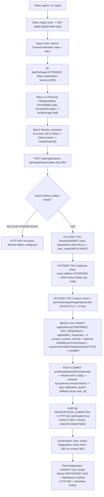
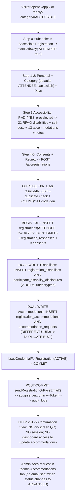
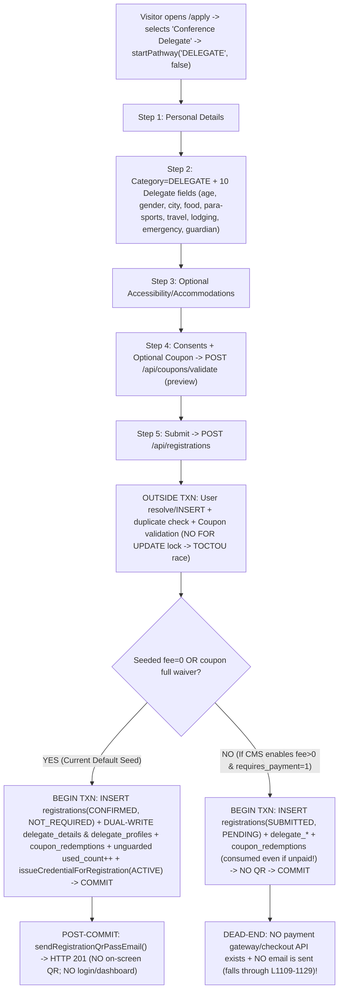
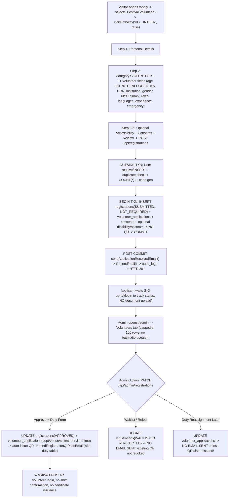
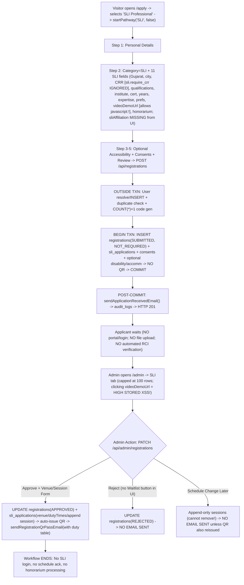

# End-to-End Registration Workflows & Status State Machines

**Project:** Purple Festival Gujarat 2027 (`d:\purplefestgujarat`)  
**Audit Scope:** Part C (Section 10 — All 5 Registration Pathways) & Part I (Section 29 — All 6 Status State Machines)  
**Evidence Basis:** Direct line-by-line inspection of `apply/index.php`, `assets/js/registration-wizard.js`, `api/registrations/index.php`, `api/coupons/validate.php`, `api/admin/registrations.php`, `includes/qr-service.php`, `includes/mailer.php`, `api/admin/users.php`, and live read-only staging HTTP probes.

---

## Part 1 — Separate End-to-End Registration Pathway Flows (Section 10)

### 1.1 Pathway 1: General Attendee (`ATTENDEE`)



### 1.2 Pathway 2: Person with Disability / Accessible Registration (`ACCESSIBLE` UI Modifier)

> **Key Architectural Finding:** `ACCESSIBLE` is **NOT** a backend registration category. `registration-wizard.js:94-100, 352-363` maps it to `categoryCode = "ATTENDEE"` with `isPersonWithDisability = "YES"` preselected (user may still switch `categoryCode` in Step 2).



### 1.3 Pathway 3: Conference Delegate (`DELEGATE`)



### 1.4 Pathway 4: Festival Volunteer (`VOLUNTEER`)



### 1.5 Pathway 5: Sign Language Interpreter (`SLI`)



---

## Part 2 — Complete Status Inventory & 6 State-Machine Diagrams (Section 29)

### 2.1 All Statuses Defined Across the System

- **Registration Statuses (`api/admin/registrations.php:688-699` allowlist — 10 values; DB `registrations.status` is unconstrained `VARCHAR(40)`):**
  - **Active / Used:** `SUBMITTED`, `UNDER_REVIEW`, `ADDITIONAL_INFO_REQUIRED`, `APPROVED`, `CONFIRMED`, `WAITLISTED`, `REJECTED`, `CANCELLED`
  - **Defined in Allowlist / Never Set by Any Flow:** `DRAFT` (never created by wizard or API), `WITHDRAWN` (no participant withdrawal endpoint/UI exists; only referenced in duplicate-check exclusion and allowlist)
  - **Backend Transition Validation:** **NONE.** `api/admin/registrations.php:710` accepts **any** of the 10 statuses from **any** prior status (e.g., `REJECTED` -> `CONFIRMED`, `CANCELLED` -> `DRAFT`, `ATTENDEE` -> `UNDER_REVIEW`) with zero state-transition guard!
- **Payment Statuses (`registrations.payment_status`):** `NOT_REQUIRED` (default), `PENDING` (paid fee>0), `CAPTURED` (referenced in `qr-service.php:293` eligibility check, **never written anywhere** — no payment API exists).
- **Accommodation Statuses (`api/admin/accommodations.php:214`):** `REQUESTED`, `IN_PROGRESS`, `ARRANGED`, `DECLINED`, `ASSIGNED`, `COMPLETED` (UI only exposes first 4; `ASSIGNED`/`COMPLETED` are backend aliases).
- **QR Credential Statuses (`qr_credentials.status`):** `ACTIVE`, `REVOKED` (only 2 values; no `EXPIRED` or `SUSPENDED`).
- **Staff Account States (`users.is_active`, `locked_until`, `deleted_at`):** `ACTIVE` (`is_active=1, deleted_at IS NULL`), `LOCKED` (`locked_until > NOW()`), `INACTIVE` (`is_active=0`), `SOFT_DELETED` (`deleted_at IS NOT NULL`, never set by any API).

### 2.2 State Machine 1: Attendee (and Accessible) Registration

```mermaid
stateDiagram-v2
    [*] --> CONFIRMED : POST /api/registrations (instant QR + email)
    CONFIRMED --> CANCELLED : Admin PATCH (NO email; active QR NOT auto-revoked!)
    CONFIRMED --> REJECTED : Admin PATCH (unrestricted transition; NO email; QR NOT revoked!)
    CONFIRMED --> UNDER_REVIEW : Admin PATCH (unrestricted - illogical transition allowed!)
    CANCELLED --> CONFIRMED : Admin PATCH (restores status; auto-issues QR if none active)
    REJECTED --> CONFIRMED : Admin PATCH (unrestricted)
    note right of CONFIRMED
        DRAFT & WITHDRAWN exist in allowlist
        but are unreachable by participants.
        Backend enforces NO transition graph.
    end note
```

### 2.3 State Machine 2: Delegate Registration

```mermaid
stateDiagram-v2
    [*] --> CONFIRMED : POST /api/registrations (fee=0 or 100% coupon waiver -> instant QR + email)
    [*] --> SUBMITTED_PENDING : POST /api/registrations (if CMS enables fee>0 & requires_payment=1 -> NO QR, NO email, DEAD-END)
    SUBMITTED_PENDING --> CONFIRMED : Admin manual override ONLY (no payment gateway exists; payment_status stays PENDING -> QR blocked!)
    CONFIRMED --> CANCELLED : Admin PATCH (coupon NOT refunded; QR NOT auto-revoked; NO email)
    CONFIRMED --> REJECTED : Admin PATCH (NO email; QR NOT auto-revoked)
```

### 2.4 State Machine 3: Volunteer Application

```mermaid
stateDiagram-v2
    [*] --> SUBMITTED : POST /api/registrations (acknowledgment email; NO QR)
    SUBMITTED --> UNDER_REVIEW : Admin PATCH (NO email)
    SUBMITTED --> ADDITIONAL_INFO_REQUIRED : Admin PATCH (NO email; applicant has NO way to reply!)
    SUBMITTED --> WAITLISTED : Admin PATCH (NO email)
    SUBMITTED --> APPROVED : Admin PATCH (auto-issues QR + pass email w/ duty table)
    SUBMITTED --> REJECTED : Admin PATCH (NO email)
    UNDER_REVIEW --> APPROVED : Admin PATCH (auto-issues QR + pass email)
    UNDER_REVIEW --> WAITLISTED : Admin PATCH (NO email)
    UNDER_REVIEW --> REJECTED : Admin PATCH (NO email)
    WAITLISTED --> APPROVED : Admin PATCH (auto-issues QR + pass email)
    APPROVED --> CANCELLED : Admin PATCH (active QR NOT auto-revoked; NO email)
    APPROVED --> REJECTED : Admin PATCH (active QR NOT auto-revoked; NO email)
```



### 2.5 State Machine 4: SLI Professional Application

```mermaid
stateDiagram-v2
    [*] --> SUBMITTED : POST /api/registrations (acknowledgment email; NO QR)
    SUBMITTED --> UNDER_REVIEW : Admin PATCH (detail modal only; NO email)
    SUBMITTED --> ADDITIONAL_INFO_REQUIRED : Admin PATCH (detail modal only; NO email; NO reply UI)
    SUBMITTED --> APPROVED : Admin PATCH (SLI tab or modal -> auto-issues QR + pass email w/ venue/sessions)
    SUBMITTED --> REJECTED : Admin PATCH (SLI tab or modal -> NO email)
    SUBMITTED --> WAITLISTED : Admin PATCH (modal only - missing Waitlist button in SLI tab; NO email)
    APPROVED --> CANCELLED : Admin PATCH (active QR NOT auto-revoked; NO email)
```



### 2.6 State Machine 5: QR Credential Lifecycle

```mermaid
stateDiagram-v2
    [*] --> ACTIVE : issueCredentialForRegistration() (on instant confirm or admin approve/ISSUE)
    ACTIVE --> REVOKED : Admin REVOKE (manual; NO email sent)
    ACTIVE --> REVOKED : Admin REISSUE (creates new -R{N} ACTIVE row, then revokes old; non-transactional race!)
    REVOKED --> [*] : Terminal (no expiry state exists!)
    note right of ACTIVE
        BUG 1: Changing registration to REJECTED/CANCELLED
        leaves credential ACTIVE (blocked only by reg status check).
        BUG 2: Manual registration_code lookup after REISSUE
        matches old REVOKED row and blocks entry!
    end note
```

### 2.7 State Machine 6: Staff Account Lifecycle (`SUPERADMIN`, `ADMIN`, `RGST`)

```mermaid
stateDiagram-v2
    [*] --> ACTIVE : CLI bootstrap-superadmin.php OR Superadmin POST /api/admin/users
    ACTIVE --> LOCKED_15M : 5 failed password attempts (HTTP 423; MFA failures do NOT lock)
    LOCKED_15M --> ACTIVE : 15m elapsed (BUG: counter stays >=5 so 1 typo re-locks immediately!)
    ACTIVE --> INACTIVE : Superadmin PATCH isActive=false (revokes all sessions; blocks self-deactivate)
    INACTIVE --> ACTIVE : Superadmin PATCH isActive=true
    ACTIVE --> ACTIVE : Superadmin PATCH newPassword (BUG: does NOT revoke active sessions!)
    ACTIVE --> ACTIVE : Superadmin PATCH roleCode (BUG: allows SUPERADMIN self-demotion!)
    note right of INACTIVE
        deleted_at soft-delete column exists
        but NO delete endpoint/UI is implemented.
    end note
```

