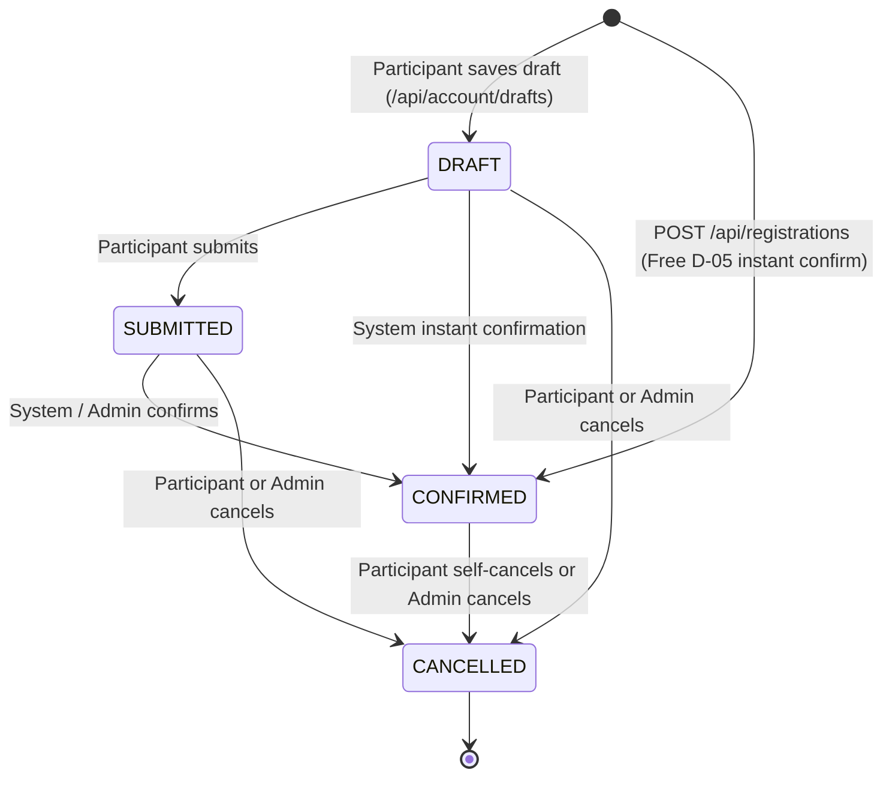
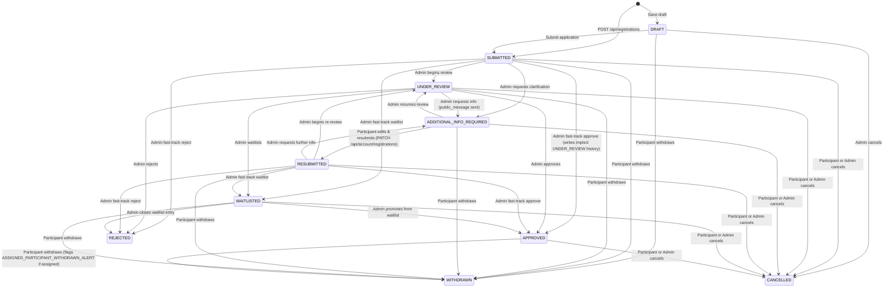
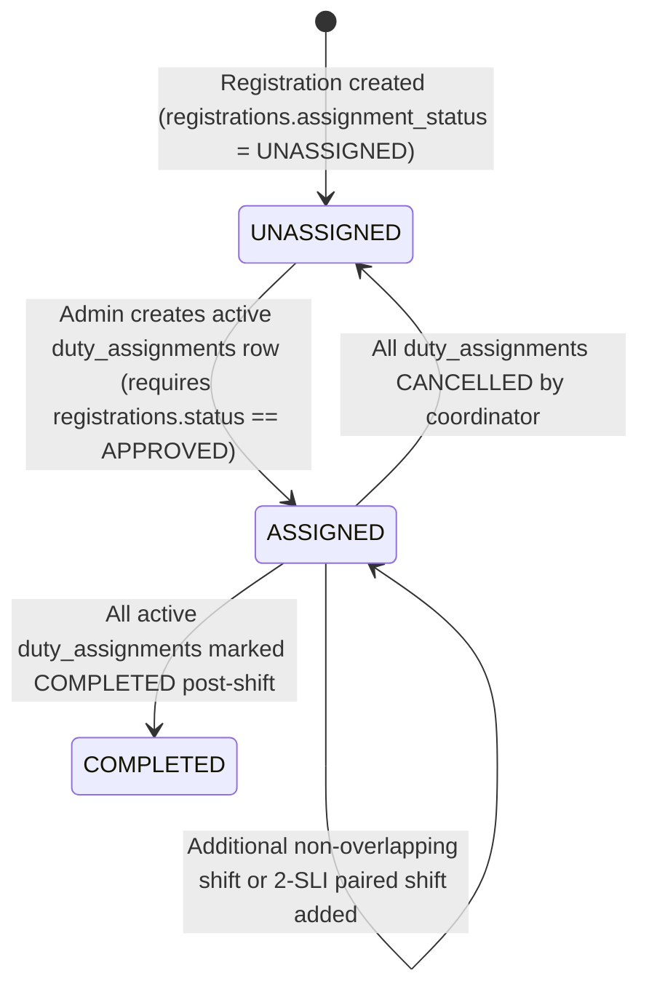
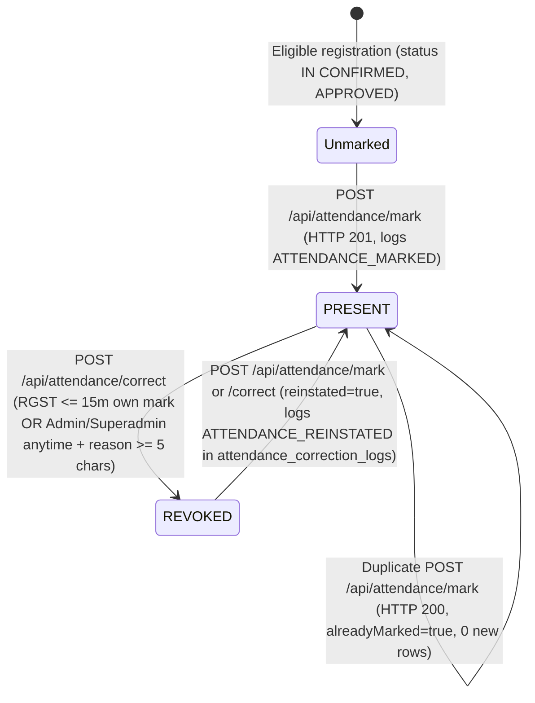

# Application State Machines & Decoupled Lifecycle Specification

**Authoritative Implementation:** `includes/application-lifecycle.php`, `includes/admin-common.php`, `api/registrations/index.php`, `api/account/registrations.php`, `api/admin/registrations.php`, `api/admin/assignments.php`, `api/attendance/mark.php`, `api/attendance/correct.php`  
**Governance References:** `CAD-02`, `CAD-05`, `CAD-06`, `CAD-13`, `D-01`, `D-02`, `D-03`, `D-16`, `D-17`, `D-18`, `HIGH-02`

---

## 1. Strict Separation of Three Lifecycle Dimensions

Purple Festival Gujarat 2027 enforces an absolute architectural separation between **Application Approval**, **Operational Duty Assignment**, and **Physical Event-Day Attendance**. Mutating one dimension never implicitly mutates another:

| Dimension | Authoritative Storage | Allowed Values | Transition Authority | Strict Decoupling Rule |
|---|---|---|---|---|
| **1. Application Approval Status** | `registrations.status` + `registration_status_history` (append-only) | `DRAFT`, `SUBMITTED`, `UNDER_REVIEW`, `ADDITIONAL_INFO_REQUIRED`, `RESUBMITTED`, `CONFIRMED`, `APPROVED`, `WAITLISTED`, `REJECTED`, `WITHDRAWN`, `CANCELLED` | `PARTICIPANT` (submit, edit/resubmit, withdraw/cancel), `ADMIN`/`SUPERADMIN` (review decisions, cancel), `SYSTEM` (instant free Attendee confirm) | Approving or confirming a registration **never** creates an `attendance_records` row, **never** issues a `qr_credentials` row (`D-01`), and **never** auto-assigns a duty shift. |
| **2. Duty Assignment Status** (Volunteers & SLIs) | `registrations.assignment_status` + `duty_assignments.status` | `registrations.assignment_status`: `UNASSIGNED`, `ASSIGNED`, `COMPLETED` · `duty_assignments.status`: `ASSIGNED`, `COMPLETED`, `CANCELLED` | `ADMIN` (`volunteers.review`, `sli.review`, `programme.manage`, `registrations.write`) / `SUPERADMIN` via `/api/admin/assignments` | Only `APPROVED` Volunteers/SLIs can be assigned a duty (`400` if unapproved). If an already-`ASSIGNED` participant later withdraws (`WITHDRAWN`/`CANCELLED`), `duty_assignments` rows are preserved for coordinator visibility and `ASSIGNED_PARTICIPANT_WITHDRAWN_ALERT` is logged to `audit_logs`. |
| **3. Physical Event-Day Attendance** | `attendance_records.status` + `attendance_correction_logs` (append-only) | `PRESENT`, `REVOKED` (per `edition_id`, `registration_id`, `attendance_date_ist` in `2027-01-21..23`, `attendance_scope`) | `RGST`, `ADMIN`, `SUPERADMIN` via `/rgst` (`/api/attendance/mark` & `/api/attendance/correct`) | Only registrations with `registrations.status IN ('CONFIRMED', 'APPROVED')` are eligible to be marked `PRESENT`. Marking or revoking physical attendance **never** changes `registrations.status` or `registrations.assignment_status`. |

---

## 2. Dimension 1 — Application Approval State Machines (`includes/application-lifecycle.php`)

### 2.1 General Attendee (`ATTENDEE`) State Machine

Under the default free registration policy (`D-05`), General Attendee submissions transition immediately to `CONFIRMED` within the atomic registration transaction.

#### Allowed `ATTENDEE` Transitions (`pfgGetAllowedStatusTransitions`)

| Current Status | `PARTICIPANT` Allowed Targets | `ADMIN` / `SUPERADMIN` / `SYSTEM` Allowed Targets | Triggered Notification (`notification_queue` + `in_app_notifications`) |
|---|---|---|---|
| `DRAFT` | `SUBMITTED`, `CANCELLED` | `SUBMITTED`, `CONFIRMED`, `CANCELLED` | `ATTENDEE_REGISTRATION_CONFIRMED` (on `CONFIRMED`) |
| `SUBMITTED` | `CANCELLED` | `CONFIRMED`, `CANCELLED` | `ATTENDEE_REGISTRATION_CONFIRMED` / `ATTENDEE_REGISTRATION_CANCELLED` |
| `CONFIRMED` | `CANCELLED` *(self-editable profile/logistics/accommodations remain open via `PATCH /api/account/registrations`)* | `CANCELLED` | `ATTENDEE_REGISTRATION_UPDATED` (on edit) / `ATTENDEE_REGISTRATION_CANCELLED` (on cancel) |
| `CANCELLED` | *(Terminal)* | *(Terminal)* | — |

---

### 2.2 Festival Volunteer (`VOLUNTEER`) & Sign Language Interpreter (`SLI`) State Machine

Volunteer and SLI applications are review-gated (`D-17`). Coordinators can either step through `UNDER_REVIEW` or fast-track a decision directly from `SUBMITTED` or `RESUBMITTED` (which automatically writes an implicit `UNDER_REVIEW` row into `registration_status_history` before recording the decision row).

#### Allowed `VOLUNTEER` / `SLI` Transitions (`pfgGetAllowedStatusTransitions`)

| Current Status | `PARTICIPANT` Allowed Targets | `ADMIN` / `SUPERADMIN` Allowed Targets | Triggered Notification Template (`VOLUNTEER_*` / `SLI_*`) |
|---|---|---|---|
| `DRAFT` | `SUBMITTED`, `WITHDRAWN` | `SUBMITTED`, `CANCELLED` | `VOLUNTEER_APPLICATION_RECEIVED` / `SLI_APPLICATION_RECEIVED` (on `SUBMITTED`) |
| `SUBMITTED` | `WITHDRAWN`, `CANCELLED` *(editable in-place via `PATCH` while `SUBMITTED`)* | `UNDER_REVIEW`, `APPROVED`, `REJECTED`, `WAITLISTED`, `ADDITIONAL_INFO_REQUIRED`, `CANCELLED` | Corresponding decision template or in-app `registration.status_under_review` |
| `UNDER_REVIEW` | `WITHDRAWN`, `CANCELLED` | `APPROVED`, `REJECTED`, `WAITLISTED`, `ADDITIONAL_INFO_REQUIRED`, `CANCELLED` | `*_APPLICATION_APPROVED`, `*_APPLICATION_REJECTED`, `*_APPLICATION_WAITLISTED`, `*_INFO_REQUESTED` |
| `ADDITIONAL_INFO_REQUIRED` | `RESUBMITTED` *(automatic on `PATCH /api/account/registrations`)*, `WITHDRAWN`, `CANCELLED` | `UNDER_REVIEW`, `CANCELLED` | In-app `registration.status_resubmitted` + `resubmissionNote` saved in `registration_status_history.public_message` |
| `RESUBMITTED` | `WITHDRAWN`, `CANCELLED` | `UNDER_REVIEW`, `APPROVED`, `REJECTED`, `WAITLISTED`, `ADDITIONAL_INFO_REQUIRED`, `CANCELLED` | Corresponding decision template |
| `WAITLISTED` | `WITHDRAWN`, `CANCELLED` | `APPROVED`, `REJECTED`, `CANCELLED` | `*_APPLICATION_APPROVED` / `*_APPLICATION_REJECTED` |
| `APPROVED` | `WITHDRAWN`, `CANCELLED` | `CANCELLED` | `ATTENDEE_REGISTRATION_CANCELLED` (+ `ASSIGNED_PARTICIPANT_WITHDRAWN_ALERT` audit log if `assignment_status = 'ASSIGNED'`) |
| `REJECTED` / `WITHDRAWN` / `CANCELLED` | *(Terminal)* | *(Terminal)* | — |

---

## 3. Actor Resolution & Self-Service Safety (`HIGH-02`)

1. **Explicit Participant Actor Context on Self-Service Endpoints:**
   - A staff member (`ADMIN` or `SUPERADMIN`) may also hold a personal participant registration.
   - `api/account/registrations.php` explicitly passes `array_merge($user, ['actorType' => 'PARTICIPANT'])` into `pfgTransitionRegistrationStatus()` on self-service `PATCH` (resubmission from `ADDITIONAL_INFO_REQUIRED -> RESUBMITTED`) and `POST` (`action: "withdraw" | "cancel"`), ensuring staff-owned personal applications follow participant transition rules rather than failing on admin transition rules.
2. **Strict Separation of Internal Admin Notes vs. Participant-Facing Messages:**
   - Every transition in `registration_status_history` stores `reason` (internal admin audit note) and `public_message` (participant-visible guidance) in separate columns.
   - `pfgGetTransitionNotificationSpec()`, `/api/account/dashboard`, and `/api/account/registrations` expose **only** `public_message` / `public_review_note` and **never** leak `reason` or `registrations.review_notes` to participants.

---

## 4. Dimension 2 — Operational Duty Assignment Lifecycle (`api/admin/assignments.php`)

- **Eligibility Gate:** `POST /api/admin/assignments` verifies `registrations.category_code IN ('VOLUNTEER', 'SLI')` and `registrations.status === 'APPROVED'` (`HTTP 400` otherwise).
- **Overlap Detection & Audited Override:** Checks existing `ASSIGNED` duties for the same `registration_id` on `duty_date_ist` where `start_time < :end_time AND end_time > :start_time`. Returns `HTTP 409 Conflict` (`code: "DUTY_OVERLAP"`) with conflicting shift details unless an authorized coordinator supplies a non-empty `overrideReason`, which is persisted in `duty_assignments.override_reason` and audited in `audit_logs` (`DUTY_ASSIGNMENT_OVERLAP_OVERRIDDEN`).
- **2-SLI Rotation Pairing:** Supports `pairing_group_id` UUID linking two Sign Language Interpreters assigned to the same session (`Programme_Grid.xlsx` 20–30 minute rotation model) and emits a warning if an `isl_required = 1` session has fewer than 2 assigned SLIs.

---

## 5. Dimension 3 — Physical Event-Day Attendance Lifecycle (`api/attendance/*`)

- **Zero Row Deletion:** Revoking an accidental mark updates `attendance_records.status = 'REVOKED'` under `SELECT ... FOR UPDATE` row locking and appends an immutable audit record to `attendance_correction_logs` (`previous_status = 'PRESENT'`, `new_status = 'REVOKED'`, `reason`, `actor_user_id`, `actor_role`).
