# Database Relationship Diagram — Purple Festival Gujarat 2027

The diagram below shows the canonical post-Phase 3 entity-relationship model (`62` tables total; `62` enforced foreign keys). All Phase 3 relationships enforce `ON DELETE RESTRICT` or `ON DELETE SET NULL` (zero destructive cascades on participant, consent, attendance, or audit records). Archived legacy duplicate tables (`registration_accommodations`, `registration_disabilities`, `delegate_profiles`, `coupon_codes`, `payments`, `notification_jobs`) are preserved read-only and omitted from active write paths.

```mermaid
erDiagram
    festival_editions ||--o{ registration_categories : "defines (PRIMARY/LEGACY)"
    festival_editions ||--o{ registrations : "hosts"
    festival_editions ||--o{ registration_number_sequences : "allocates monotonic IDs"
    festival_editions ||--o{ venues : "uses"
    festival_editions ||--o{ checkin_stations : "operates desks"
    festival_editions ||--o{ attendance_records : "tracks manual attendance"
    festival_editions ||--o{ programme_items : "publishes"
    festival_editions ||--o{ cms_pages : "owns"
    festival_editions ||--o{ faq_items : "publishes"
    festival_editions ||--o{ announcements : "publishes"

    venues ||--o{ checkin_stations : "contains"
    organizations ||--o{ partners : "represented by"
    cms_pages ||--o{ cms_sections : "contains"

    users ||--o{ user_roles : "assigned"
    roles ||--o{ user_roles : "granted to"
    roles ||--o{ role_permissions : "includes"
    permissions ||--o{ role_permissions : "defines"
    users ||--o{ sessions : "holds"
    users ||--o{ password_reset_tokens : "requests"
    users ||--o{ auth_accounts : "links"

    users ||--o{ registrations : "submits"
    users ||--o{ registrations : "reviews (reviewer_id)"
    registration_categories ||--o{ registrations : "classifies"

    registrations ||--o| registration_responses : "sanitized snapshot"
    registrations ||--o| volunteer_applications : "VOLUNTEER details"
    registrations ||--o| sli_applications : "SLI details"
    registrations ||--o| delegate_details : "legacy DELEGATE details"
    registrations ||--o{ privacy_consent_records : "DPDP consents"
    users ||--o{ privacy_consent_records : "grants"

    registrations ||--o{ participant_disability_disclosures : "optional encrypted"
    disability_categories ||--o{ participant_disability_disclosures : "RPwD 21 taxonomy"
    registrations ||--o{ accommodation_requests : "encrypted requests"
    accommodation_requests ||--o{ accommodation_assignments : "coordinator work"
    users ||--o{ accommodation_assignments : "assigned coordinator"

    registrations ||--o{ attendance_records : "manual day attendance (D-01)"
    users ||--o{ attendance_records : "marked_by RGST/Admin"
    checkin_stations ||--o{ attendance_records : "station_id"
    attendance_records ||--o{ attendance_correction_logs : "audited corrections"

    registrations ||--o{ qr_credentials : "historical read-only (D-01)"
    qr_credentials ||--o{ checkins : "historical read-only"
    qr_credentials ||--o{ credential_events : "historical audit"

    coupons ||--o{ coupon_redemptions : "redeemed (D-05)"
    registrations ||--o{ coupon_redemptions : "applied to"
    registrations ||--o{ payment_orders : "deferred payments (D-05)"

    users ||--o{ notification_queue : "recipient"
    notification_queue ||--o{ notification_delivery_logs : "provider events"

    users ||--o{ audit_logs : "actor"
    users ||--o{ admin_actions : "admin / target"
```

## Key Architectural Boundaries

1. **Identity vs. Registration (`users` 1:N `registrations`):** A single participant account can hold distinct applications (e.g., `ATTENDEE` + `VOLUNTEER`), while `registration_number_sequences` allocates a globally unique, monotonic `PFG-2027-NNNNNN` code per registration.
2. **Manual Attendance Decoupling (`attendance_records`):** Keyed on `(edition_id, registration_id, attendance_date_ist, attendance_scope)` with **zero FK to `qr_credentials`**, enabling Day 1/2/3 manual desk verification under Decision `D-01`.
3. **Sensitive Disclosure Isolation:** Disability disclosures (`participant_disability_disclosures`) and accessibility requests (`accommodation_requests`) live in dedicated tables with AES-256-GCM ciphertext (`enc:v1:`) on all free-text fields and strict RBAC + `SENSITIVE_DATA_READ` auditing.

