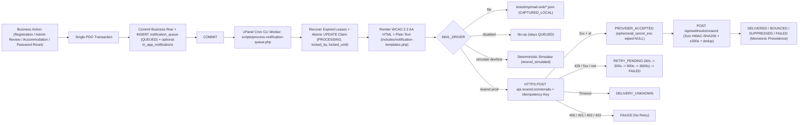

# Notification Architecture — Purple Festival Gujarat 2027

**Canonical Modules:**
- `includes/notification-templates.php` — 29-template WCAG 2.2 AA registry, prohibited-field privacy filter & multipart HTML/plain-text renderer
- `includes/notification-service.php` — Transactional outbox, lease-based queue claiming, Resend/file/disabled/simulate transport, retry backoff, admin recovery, Svix webhook processor & in-app notification writer
- `includes/mailer.php` — Backward-compatible thin facade delegating to `notification-service.php`
- `scripts/process-notification-queue.php` — Bluehost cPanel Cron CLI queue worker (bounded batch + wall-clock limit)
- `api/webhooks/resend.php` — Svix HMAC-SHA256 authenticated Resend delivery webhook endpoint
- `api/admin/notifications.php` — Permission-controlled (`ADMIN`/`SUPERADMIN` + MFA + CSRF) inspection, retry & intentional resend API

---

## 1. End-to-End Transactional Outbox & Delivery Flow

---

## 2. Separation of Concerns (4 Distinct Layers)

| Layer | Backing Table / Component | Responsibility |
|---|---|---|
| **1. Underlying Business Event** | `registrations`, `volunteer_applications`, `sli_applications`, `accommodation_requests`, `users` | Authoritative festival state; never rolled back if email provider is down |
| **2. Email Delivery Outbox** | `notification_queue` + `notification_delivery_logs` | Guaranteed transactional creation, idempotent deduplication, worker leasing, retries, and provider webhook reconciliation |
| **3. In-Application Notification** | `in_app_notifications` | Decoupled participant portal feed (linked via `source_queue_id`, `is_read`, `read_at`) ready for Phase 10 UI |
| **4. Future Optional Channels** | `notification_queue.channel` (`EMAIL`; extensible to `SMS`/`WHATSAPP`) | Extensible schema only; **zero** SMS/WhatsApp gateway procurement or integration pending Decision `D-11` |

---

## 3. Idempotency & Resend Semantics (5 Distinct Cases)

1. **Duplicate Business Submission:** Same `idempotency_key` (e.g. `reg-confirm:<regId>`) -> `pfgEnqueueNotification()` returns existing queue record (`deduped: true`), creating **zero** duplicate emails.
2. **Failed Delivery Retry:** Worker re-claims the **same** queue row when `next_retry_at <= NOW()`, sending the **same** Resend `Idempotency-Key` header (within Resend's 24-hour window) so network retries cannot double-send.
3. **Abandoned Worker Reprocessing:** If a worker dies while `status = 'PROCESSING'`, `pfgRecoverAbandonedNotifications()` resets expired `locked_until < NOW()` rows to `RETRY_PENDING` (or `DELIVERY_UNKNOWN` if `attempts >= max_attempts`).
4. **Legitimate Administrative Resend:** `pfgAdminResendNotification()` creates a **new** queue row with `resent_from_id = <original_id>` and a fresh `idempotency_key = admin-resend:<origId>:<uuid>`, audited in `audit_logs` and `notification_delivery_logs` without touching application approval status (blocked for single-use token templates like `PASSWORD_RECOVERY`).
5. **Genuinely New Event:** Distinct business transition (e.g., `admin-reg:<regId>:status:WAITLISTED` vs `admin-reg:<regId>:status:APPROVED`) produces a distinct `idempotency_key` and sends a distinct notification.
