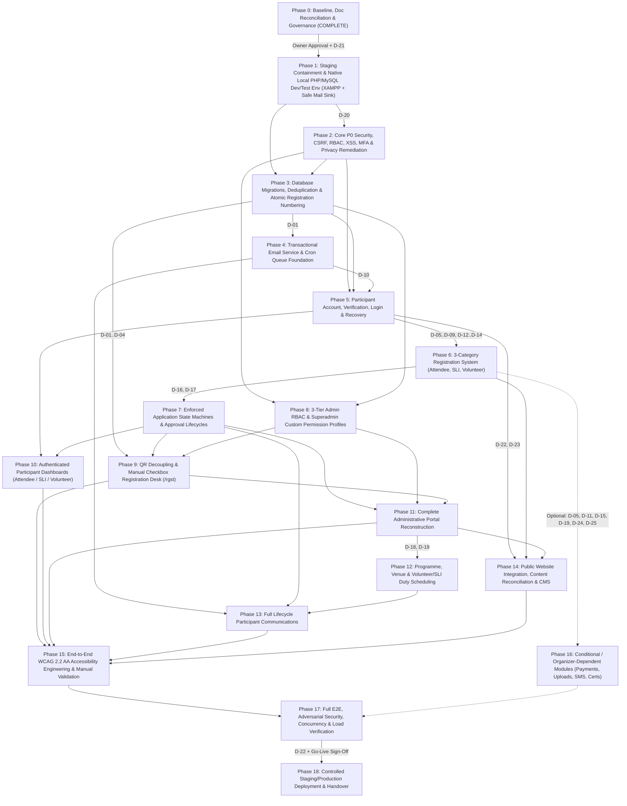

# Phase Dependency Map & Module Impact Matrix (Phases 0 – 18)

**Project:** Purple Festival Gujarat 2027 (`d:\purplefestgujarat`)  
**Principle:** Dependent phases cannot begin until entry prerequisites and blocking Owner Decisions are resolved. Independent local groundwork may proceed only where dependencies explicitly permit.

---

## 1. Refined Phase Dependency Graph

---

## 2. Phase-Wise Affected Modules & Blocking Decisions Matrix

| Phase | Core Objective | Primary Affected Modules / Files | Entry Prerequisites | Blocking Owner Decisions |
|---|---|---|---|---|
| **Phase 0** | Baseline & Source Reconciliation | `project-docs/*` only (0 app files) | None | None |
| **Phase 1** | Staging Containment & Native PHP/MySQL Dev/Test Env | `.htaccess`, `.gitignore`, `.cpanel.yml`, `includes/config.php` (fail-closed env & `APP_ENV`), `includes/database.php` (block silent SQLite in prod/staging), `includes/qr-service.php` (remove fallback secret), `includes/mailer.php` (safe local `file` mail sink), `scripts/verify-bluehost-env.php`, `tests/run.php`, `tests/phase1_containment_test.php`, `project-docs/LOCAL_DEV_SETUP.md` | Phase 0 sign-off | Authorization to proceed (GRANTED); `D-21` before any staging DB writes |
| **Phase 2** | Core P0 Security & RBAC Remediation | `includes/auth.php`, `includes/config.php`, `login.php`, `auth/login.php`, `apply/index.php`, `admin/index.php`, `api/auth/*`, `api/admin/{cms,audit-logs,registrations,overview,users}.php`, `api/account/*`, `includes/mailer.php` (strip `api.qrserver.com` & plaintext tokens) | Phase 1 (local runtime + security test harness) | `D-20` (MFA enforcement policy), `D-27` (privacy rules) |
| **Phase 3** | Database Migrations, Deduplication & Atomic IDs | `database/migrations/*`, `database/schema.sql`, `database/seed.sql`, `includes/database.php`, new `includes/registration-id.php`, `includes/qr-service.php` (extract ID gen) | Phase 1, Phase 2 | `D-01` (QR retention), `D-06` (Delegate tables), `D-21` (legacy data) |
| **Phase 4** | Transactional Email & Cron Queue | `includes/mailer.php`, new `includes/notification-service.php`, new `scripts/process-notification-queue.php`, `database/migrations/*` (`notification_queue` schema fix) | Phase 3 | `D-01` (email QR removal), `D-11` (channel design), `D-22` (DNS domain — config only) |
| **Phase 5** | Participant Auth, Verification & Recovery | `login.php`, new `/register` / `/verify-email` / `/forgot-password` / `/reset-password`, `api/auth/{signup,login,logout,me,password-reset,verify-email}.php`, `includes/auth.php` | Phase 2, Phase 3, Phase 4 | `D-10` (auth & verification method), `D-09` (multi-category), `D-21` (legacy claim flow) |
| **Phase 6** | 3-Category Registration (`ATTENDEE`, `SLI`, `VOLUNTEER`) | `apply/index.php`, `assets/js/registration-wizard.js`, `api/registrations/index.php`, shared form validators | Phase 5 | `D-05`, `D-06`, `D-07`, `D-08`, `D-09`, `D-12`, `D-13`, `D-14` |
| **Phase 7** | Enforced State Machines & Approvals | new `includes/application-lifecycle.php`, `api/registrations/index.php`, `api/admin/registrations.php` | Phase 6 | `D-16` (edit/withdraw rules), `D-17` (approval/waitlist rules) |
| **Phase 8** | 3-Tier Admin RBAC & Custom Operational Roles | `includes/auth.php`, `includes/config.php`, `api/admin/users.php`, new `api/admin/roles.php`, `assets/js/admin-portal.js` (Staff & Roles) | Phase 2, Phase 3 | `D-20` (MFA), `D-03` (RGST correction perm) |
| **Phase 9** | QR Decoupling & Manual Attendance `/rgst` | `rgst/index.php`, new `api/attendance/*`, retire `api/qr/verify.php` & `assets/js/html5-qrcode.min.js`, retain `assets/js/qrcode-gen.js` (MFA), update `api/admin/overview.php` | Phase 3, Phase 7, Phase 8 | `D-01`, `D-02`, `D-03`, `D-04` |
| **Phase 10** | Participant Dashboards | `dashboard/index.php`, `api/account/{profile,accommodations,applications,notifications}.php`, `dashboard/pass-print.php` (confirmation slip) | Phase 5, Phase 7 | `D-09`, `D-16` |
| **Phase 11** | Complete Admin Portal Reconstruction | `admin/index.php`, `assets/js/admin-portal.js`, all `api/admin/*.php` (pagination, full detail view, CSV sanitization, communications center, accurate KPIs) | Phase 7, Phase 8, Phase 9 | `D-17`, `D-27` |
| **Phase 12** | Programme, Venue & Duty Scheduling | `api/admin/{programme,venues,assignments}.php`, `assets/js/admin-portal.js`, `dashboard/index.php` (live schedule view) | Phase 11 | `D-18`, `D-19`, `D-23` |
| **Phase 13** | Complete Lifecycle Notifications | `includes/notification-service.php`, email templates, triggers across `api/auth/*`, `api/registrations/*`, `api/admin/*`, `api/account/*` | Phase 4, Phase 7, Phase 12 | `D-01`, `D-11` |
| **Phase 14** | Public Website & CMS Integration | `includes/header.php`, `includes/footer.php`, `index.php`, `programme.php`, `accessibility.php`, `api/admin/cms.php` | Phase 5, Phase 6, Phase 11 | `D-22`, `D-23` |
| **Phase 15** | WCAG 2.2 AA Accessibility Engineering & Validation | `assets/css/{app,disabilities-section,partners-section,viksit-section}.css`, `assets/js/{accessibility,registration-wizard,admin-portal}.js`, `includes/*`, `rgst/index.php`, `dashboard/index.php`, `login.php`, email templates | Phases 9, 10, 11, 13, 14 (applied continuously too!) | `D-26` (language scope) |
| **Phase 16** | Conditional Organizer Modules | Payments/Razorpay, private document uploads, SMS/WhatsApp, certificates, athlete/exhibitor inquiry hooks (ONLY if approved) | Phase 6+ | `D-05`, `D-07`, `D-11`, `D-15`, `D-19`, `D-24`, `D-25` |
| **Phase 17** | E2E, Adversarial Security, Concurrency & Load Testing | `tests/` (PHPUnit, API/integration, Playwright + axe-core, concurrency scripts, 46-finding security regression matrix) | Phase 15 (+ Phase 16 if any) | None |
| **Phase 18** | Controlled Staging/Production Deployment & Handover | `.cpanel.yml`, `.github/workflows/*`, `.htaccess`, Bluehost cron/env/SSL/DNS, `OPERATIONS_HANDBOOK.md`, `DEPLOYMENT_CHECKLIST.md`, `ROLLBACK_PLAN.md` | Phase 17 (all P0/P1 closed) | `D-22` (domain) + explicit Production Release Approval |

