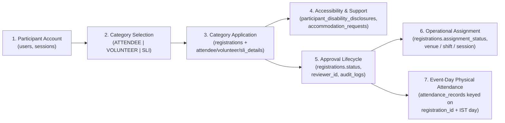
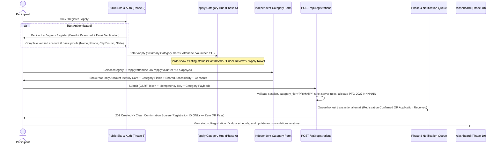

# Proposed Registration Architecture & End-to-End Workflows

**Status:** Pre-Phase 6 Architectural Reconciliation Blueprint (**NOT YET IMPLEMENTED** — strictly gated behind Phase 4 Communications, Phase 5 Participant Authentication, and Owner Sign-Off on [REGISTRATION_OWNER_DECISIONS.md](REGISTRATION_OWNER_DECISIONS.md))  
**Stack Constraint (`CAD-01`, `CAD-11`):** Native PHP 8 + MySQL/MariaDB (InnoDB `utf8mb4`) + PDO + Vanilla JavaScript + HTML5 + CSS3 on Bluehost Apache/cPanel. Zero frameworks, zero Docker, zero QR credential issuance (`CAD-13`).

---

## 1. Architectural Separation of Concerns

The reconciled Phase 6 registration system strictly enforces **7 decoupled operational layers** (aligned with the 11 domain concepts locked in [DATABASE_ARCHITECTURE.md](DATABASE_ARCHITECTURE.md)):

| Layer | Authoritative Table(s) | Key Boundary Rule |
| :--- | :--- | :--- |
| **1. Participant Account Identity** | `users`, `sessions`, `password_reset_tokens` | Single source of truth for Name, Verified Email, Phone/WhatsApp, City/District, State, Country, Preferred Language. **Never re-collected repeatedly** across multiple applications. |
| **2. Participation Category** | `registration_categories` (`category_tier='PRIMARY'`) | Strictly **3 public categories** (`ATTENDEE`, `VOLUNTEER`, `SLI`). Historical `LEGACY` categories (`DELEGATE`, `STUDENT`, `PROFESSIONAL`, `INSTITUTIONAL`, `ALLY`) set `is_active = 0` without deleting any historical rows. |
| **3. Category Application Details** | `registrations` + `attendee_details` / `volunteer_applications` / `sli_applications` | Independent, focused category-specific forms; atomic Registration ID (`PFG-2027-NNNNNN`) allocated via `registration_number_sequences`; `Idempotency-Key` safe retries. |
| **4. Accessibility & Accommodations** | `participant_disability_disclosures`, `accommodation_requests`, `accommodation_assignments` | Shared across all 3 categories (`CAD-07`); optional disclosure; zero diagnosis prerequisite; AES-256-GCM encrypted free text; stripped from `registration_responses`; gated behind `accommodations.read`; audited via `SENSITIVE_DATA_READ`. |
| **5. Administrative Approval** | `registrations.status`, `reviewer_id`, `review_notes`, `reviewed_at`, `admin_actions` | Strictly server-enforced state machine (Phase 7). Attendee = instant `CONFIRMED` (if free); Volunteer & SLI = coordinator review (`SUBMITTED -> UNDER_REVIEW -> APPROVED / WAITLISTED / ADDITIONAL_INFO_REQUIRED / REJECTED`). |
| **6. Operational Assignments** | `registrations.assignment_status`, `volunteer_applications.assigned_*`, `sli_applications.assigned_*` | Completely decoupled from approval `status`. Assignable only post-approval (`volunteers.review` / `sli.review`). |
| **7. Event-Day Physical Attendance** | `attendance_records`, `attendance_correction_logs` | Keyed on `(edition_id, registration_id, attendance_date_ist, attendance_scope)` in `/rgst` via manual checkboxes (Phase 9). **Zero `qr_credentials` dependency** (`CAD-06`, `CAD-13`). |

---

## 2. End-to-End Authenticated Participant Journey (`CAD-03`)

### Multi-Category Participation Rules (Pending `D-09`)
- Under recommended `D-09` Option A, **one verified participant account** can hold up to **one active registration per primary category** (e.g., a college student registers as `VOLUNTEER` and also holds an `ATTENDEE` registration for days they are off-shift).
- On the second form, the participant **never re-types** Name, Email, Phone, City/District, State, or Emergency Contact (auto-inherited from `users` / prior profile with an optional *"Update Account Profile"* shortcut), and can optionally pre-copy or customize Accessibility Accommodation preferences.

---

## 3. Reusable Native PHP & Vanilla JS Component Architecture (Phase 6 Target)

Instead of one monolithic 2,000-line wizard (`assets/js/registration-wizard.js`) mixing 5 pathways and 8 categories, Phase 6 decomposes registration into **3 lightweight independent category forms** sharing **5 reusable native PHP partials & Vanilla JS modules**:

| Reusable Component | Planned Path (Phase 6) | Shared Across |
| :--- | :--- | :--- |
| **1. Account Identity Summary Card** | `includes/form-components/account-identity-card.php` | Attendee, Volunteer, SLI |
| **2. Shared Accessibility & Accommodations Module** | `includes/form-components/shared-accessibility.php` + `assets/js/shared-accessibility.js` | Attendee, Volunteer, SLI, Dashboard |
| **3. Day × Shift Availability Grid** | `includes/form-components/shift-availability-grid.php` | Volunteer, SLI |
| **4. Shared Emergency Contact Block** | `includes/form-components/emergency-contact.php` | Attendee, Volunteer, SLI |
| **5. Shared Declarations & DPDP Consents Block** | `includes/form-components/consent-declarations.php` | Attendee, Volunteer, SLI |
| **6. Server-Side Strict Validator Library** | `includes/registration-validators.php` | `POST /api/registrations`, future edit endpoint |

### Route Structure (Preserving Existing Visual Design — `CAD-08`)
- `/apply` — Clean **3-card Primary Category Hub** (`Attendee`, `Festival Volunteer`, `Sign Language Interpreter`) showing current account status per category (and zero `ACCESSIBLE` or `DELEGATE` cards).
- `/apply/attendee` — Dedicated Attendee form (`PROPOSED_ATTENDEE_FORM.md`).
- `/apply/volunteer` — Dedicated Volunteer application form (`PROPOSED_VOLUNTEER_FORM.md`).
- `/apply/sli` — Dedicated SLI application form (`PROPOSED_SLI_FORM.md`).
- Legacy URLs (`/apply?category=DELEGATE`, `/apply?category=ACCESSIBLE`, `/apply?pathway=PWD`) redirect gracefully with an accessible banner explaining how to select Attendee/Volunteer/SLI and use the integrated Accessibility section.

---

## 4. Category-Specific Approval, Assignment & Attendance Workflows

### 4.1 Attendee Workflow (`ATTENDEE`)
1. **Submit** -> Server validates & atomically allocates `PFG-2027-NNNNNN` -> `status = 'CONFIRMED'` (when free per `D-05`), `payment_status = 'NOT_REQUIRED'`, `assignment_status = 'UNASSIGNED'`.
2. **Email (Phase 4)** -> Queues `REGISTRATION_CONFIRMED` email containing official Registration ID, attending days, and Vadodara Registration Desk instructions (**zero QR pass image**).
3. **Self-Service (Phase 10)** -> Participant can update accommodations anytime, update optional logistics, or withdraw/cancel (`CANCELLED`) in `/dashboard`.
4. **Event-Day Check-In (Phase 9)** -> `/rgst` desk searches by Registration ID or Name and toggles manual `DAY_1` / `DAY_2` / `DAY_3` attendance checkbox -> persisted atomically in `attendance_records`.

### 4.2 Volunteer & SLI Workflows (`VOLUNTEER`, `SLI`)
1. **Submit** -> Server validates category-specific credentials/roles/shifts -> allocates `PFG-2027-NNNNNN` -> `status = 'SUBMITTED'`, `assignment_status = 'UNASSIGNED'`.
2. **Email (Phase 4)** -> Queues `APPLICATION_SUBMITTED` acknowledgment email (**never implies approval**).
3. **Coordinator Review (Phase 7 & 11)** -> Authorized `ADMIN` (`volunteers.review` or `sli.review`) transitions:
   - `SUBMITTED -> UNDER_REVIEW`
   - `UNDER_REVIEW -> APPROVED` | `WAITLISTED` | `ADDITIONAL_INFO_REQUIRED` | `REJECTED`
   - If `ADDITIONAL_INFO_REQUIRED`, applicant edits & resubmits via `/dashboard` (`-> RESUBMITTED -> UNDER_REVIEW`) (`D-16`).
   - Approval triggers `APPLICATION_APPROVED` email (Phase 4/13) — **zero QR pass**.
4. **Operational Assignment (Phase 12, `D-18`)** -> Only after `status = 'APPROVED'`, coordinator assigns Venue + Date/Shift + Role/Session (with overlap detection and 2-interpreter pairing for SLIs) -> `assignment_status = 'ASSIGNED'`; visible read-only on Participant Dashboard.
5. **Event-Day Attendance (Phase 9)** -> `/rgst` marks manual physical attendance independently of approval or assignment status.

---

## 5. Legacy Category Retirement & Historical Data Preservation (`CAD-09`)

When Phase 6 is authorized:
1. **Non-Destructive Category Deactivation:** Execute a versioned Phase 6 migration setting `registration_categories.is_active = 0` for all `category_tier = 'LEGACY'` rows (`DELEGATE`, `STUDENT`, `PROFESSIONAL`, `INSTITUTIONAL`, `ALLY`). Zero rows deleted.
2. **Server Enforcement:** `POST /api/registrations` accepts ONLY `category_tier = 'PRIMARY' AND is_active = 1` (`ATTENDEE`, `VOLUNTEER`, `SLI`).
3. **Historical Record Readability:** Existing historical registrations under `DELEGATE` (with `delegate_details`), `STUDENT`, `PROFESSIONAL`, `INSTITUTIONAL`, `ALLY`, and historical `qr_credentials` / `checkins` remain 100% intact and viewable read-only in `/admin` and in their owners' `/dashboard` (claimed via verified email in Phase 5 per `D-21`).

---

## 6. Strict Phase Sequencing & Non-Mutation Gate

- **Current Phase Gate:** **ZERO** modifications have been made to `apply/index.php`, `assets/js/registration-wizard.js`, `api/registrations/index.php`, or the database schema as part of this reconciliation package.
- **Immediate Next Approved Execution Sequence (per Master Implementation Directive):**
  1. **Phase 4:** Transactional Email Service (`includes/notification-service.php`), Bluehost cPanel Cron Queue Worker (`scripts/process-notification-queue.php`), honest delivery states, and accessible HTML/plain-text email templates.
  2. **Phase 5:** Participant Account Creation, Email Verification (`D-10`), Login, Logout, Password Recovery, Session Security, and Verified-Email Legacy Account Claim (`D-21`).
  3. **Phase 6 (Only After Owner Sign-Off on `REGISTRATION_OWNER_DECISIONS.md`):** Execute the Phase 6 schema migration and build the 3 independent category forms + reusable shared components specified in this reconciliation package.
