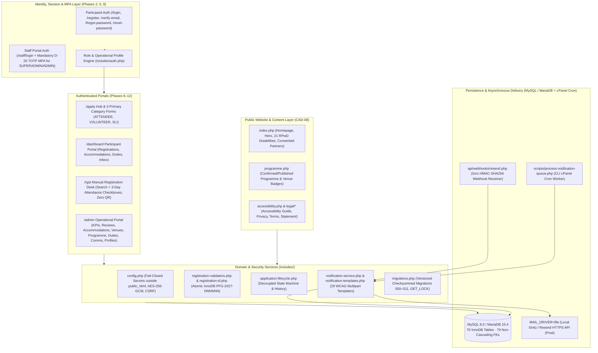

# System Architecture — Purple Festival Gujarat 2027

**Document Status:** Authoritative Architectural Specification (Phases 0–18)  
**Target Stack:** Native PHP 8.2 + MySQL 8.0 / MariaDB 10.4 (`InnoDB`, `utf8mb4_unicode_ci`) + PDO + Vanilla JavaScript + HTML5 + CSS3  
**Hosting Target:** Bluehost Shared / cPanel Apache 2.4 + MySQL + Resend HTTPS API + cPanel Cron Jobs (**Zero Docker, Zero Containers, Zero Node.js Backend, Zero Redis/RabbitMQ/PostgreSQL**)  
**Local Verification Runtime:** Windows XAMPP (`C:\xampp` — `PHP 8.2.12`, `MariaDB 10.4.32`, `Apache 2.4.58`) with isolated `pfg27_dev` / `pfg27_test` databases and local file-based email sink (`MAIL_DRIVER=file` -> `tests/tmp/mail-sink/`).  
**Live Deployment Status:** **`VERIFIED WORKING LOCALLY`** · Live Bluehost Deployment & Live Resend Delivery: **`CONFIGURATION BLOCKED`** (awaiting `D-22` domain confirmation, credentials, and explicit deployment sign-off).

---

## 1. Architectural Overview & Locked Baseline (`CAD-01` – `CAD-15`)

Purple Festival Gujarat 2027 (21–23 January 2027, Vadodara, Gujarat) is built as a security-hardened, WCAG 2.2 AA accessible, zero-daemon native PHP 8.2 web platform engineered to run directly on conventional Bluehost cPanel shared hosting without container orchestration or persistent background daemons.



---

## 2. Core Architectural Invariants

| Invariant | Implementation & Enforcement | Governance Ref |
|---|---|---|
| **Three Primary Participant Categories Only** | Only `ATTENDEE`, `VOLUNTEER`, and `SLI` (`category_tier = 'PRIMARY' AND is_active = 1`) are open for registration. Legacy categories (`DELEGATE`, `STUDENT`, `PROFESSIONAL`, `INSTITUTIONAL`, `ALLY`) are deactivated (`is_active = 0`) non-destructively while preserving all historical rows. | `CAD-02`, Migration `008` |
| **Account-Based Participant Journey** | Participants create an account (`/register`), verify their email via a 256-bit HMAC-SHA256 single-use token (`/verify-email`), log in (`/login`), apply in up to 1 active registration per primary category (`D-09` configurable default), and manage applications in `/dashboard`. Pre-Phase-5 unlinked records can be claimed via verified email (`/api/auth/claim-legacy`). | `CAD-03`, Phase 5 |
| **Three-Tier Administrative RBAC + Least-Privilege Profiles** | Administrative roles (`SUPERADMIN`, `ADMIN`, `RGST`) are strictly separated from `PARTICIPANT`. When an `ADMIN` is assigned an active operational profile (`users.permission_profile_id -> admin_permission_profiles.id`), `getUserRolesAndPermissions()` grants **only** `account.read.own` + profile permissions + explicit `custom_permissions` (never merging broad default `ADMIN` permissions, and forbidding `admin_accounts.manage`, `settings.manage`, and `audit_logs.read`). | `CAD-04`, `CRIT-01`, Migrations `009` & `011` |
| **Mandatory TOTP MFA for `SUPERADMIN` & `ADMIN`** | `enforceStaffMfaGate()` blocks un-enrolled `SUPERADMIN`/`ADMIN` users from all protected admin/attendance APIs (`HTTP 403`) until TOTP enrollment completes. Uses 160-bit RFC 6238 secrets encrypted with AES-256-GCM (`MFA_ENCRYPTION_KEY`), 30-second time-slice replay prevention, and 8 single-use bcrypt-hashed recovery codes. Self-disable is blocked (`403`) for `SUPERADMIN`/`ADMIN`. | `CAD-12`, `D-20`, Phase 2D |
| **Discontinuation of Participant Event-Entry QR Passes** | `POST /api/registrations` and admin review endpoints issue **zero** `qr_credentials`. All 29 email templates contain zero QR images and zero `api.qrserver.com` references. `GET/POST /api/qr/pass`, `POST /api/qr/verify`, and `POST /api/checkins/confirm` return `410 Gone`. `/dashboard/pass-print` renders a QR-free Registration ID confirmation sheet. `assets/js/qrcode-gen.js` is retained solely for TOTP MFA setup. | `CAD-06`, `CAD-13`, `D-01`, `HIGH-03` |
| **Manual Registration Desk (`/rgst`) & Decoupled Dimensions** | Physical attendance is tracked in `attendance_records` keyed on `UNIQUE(edition_id, registration_id, attendance_date_ist, attendance_scope)` with zero dependency on `qr_credentials`. Application approval (`registrations.status`), duty assignment (`registrations.assignment_status` + `duty_assignments`), and physical attendance (`attendance_records`) are strictly independent dimensions. | `CAD-05`, `CAD-06`, Phases 7 & 9 |
| **Cross-Category Accessibility & AES-256-GCM Privacy** | Optional disability disclosure and accommodation requests are shared uniformly across `ATTENDEE`, `VOLUNTEER`, and `SLI` (`includes/form-components/shared-accessibility.php`) without requiring a medical diagnosis to request accommodations. Free-text disclosures, accommodation notes, dietary requirements, and escort names are encrypted at rest via AES-256-GCM (`enc:v1:`), gated behind `accommodations.read`, and audited with `SENSITIVE_DATA_READ`. | `CAD-07`, Phases 2I, 3D, 6 |
| **Controlled CLI Migrations & Zero Per-Request DDL** | `includes/database.php` executes zero `CREATE`/`ALTER`/`DROP` statements during web requests. All schema evolution executes via `php database/migrate.php --up` using `includes/migrations.php` (`schema_migrations`, cross-platform LF-normalized SHA-256 checksums, `GET_LOCK` advisory locking, `70` tables, `79` non-cascading FKs across migrations `000`–`011`). | `CAD-14`, Phases 3 & 5–12 |
| **Centralized Transactional Outbox & Honest Delivery States** | All transactional emails and in-app alerts are enqueued inside the caller's PDO transaction via `pfgEnqueueNotification()` (`includes/notification-service.php`). Ephemeral verification/reset URLs are encrypted in `ephemeral_secret_enc` and wiped to `NULL` immediately upon provider handoff. Delivery statuses (`QUEUED`, `PROCESSING`, `CAPTURED_LOCAL`, `PROVIDER_ACCEPTED`, `DELIVERED`, `BOUNCED`, `FAILED`, `RETRY_PENDING`, `DELIVERY_UNKNOWN`) never equate HTTP 200 acceptance with inbox delivery. | `CAD-15`, Phase 4 |

---

## 3. Directory & Runtime File Topology

```text
purplefestgujarat/
├── .htaccess                         # Apache 2.4 routing, security headers, 403 directory/dotfile blocks
├── .user.ini                         # Bluehost FPM/LSAPI/CGI PHP INI hardening (display_errors=0, HttpOnly)
├── index.php                         # Public Homepage (Hero, Announcements, Viksit Bharat, Partners, 21 Disabilities)
├── programme.php                     # Public 3-Day Programme (CONFIRMED/PUBLISHED only + Venue confirmation badges)
├── accessibility.php                 # Public Accessibility & Inclusion Guide
├── login.php                         # Participant Login page
├── register.php                      # Participant Account Registration page
├── verify-email.php                  # Single-use Email Verification landing page
├── forgot-password.php               # Password Recovery request page
├── reset-password.php                # Password Reset completion page
├── staff/login.php                   # Isolated Staff Portal Login (Username/Email + Password + TOTP MFA)
├── auth/login.php                    # Clean 302 compatibility redirect to /login
├── apply/                            # Authenticated 3-Category Registration Portal
│   ├── index.php                     # 3-Card Category Selection Hub (ATTENDEE, VOLUNTEER, SLI)
│   ├── attendee.php                  # General Attendee registration form
│   ├── volunteer.php                 # Festival Volunteer application form
│   └── sli.php                       # Sign Language Interpreter (SLI) application form
├── dashboard/                        # Authenticated Participant Portal
│   ├── index.php                     # 5-Tab Participant Dashboard + Edit/Resubmit/Withdraw & Legacy Claim
│   └── pass-print.php                # Printable Registration ID Confirmation Sheet (zero QR)
├── rgst/                             # Registration Desk Portal
│   └── index.php                     # Manual Search + Day 1/2/3 Attendance Checkboxes + Audited Corrections
├── admin/                            # Administrative Operations Portal
│   └── index.php                     # Multi-tab Admin Portal (Overview, Registrations, Volunteers, SLIs, Accommodations, Programme/Venues, Duty Roster, Comms Center, CMS, Coupons, Staff & Profiles, Audit Logs)
├── legal/                            # Governance & Compliance Pages
│   ├── privacy.php                   # DPDP Act 2023 & Technical Safeguards Privacy Notice
│   ├── terms.php                     # Participant Terms & Code of Conduct
│   └── accessibility-statement.php   # Honest WCAG 2.2 AA Accessibility Statement
├── api/                              # JSON REST API Endpoints
│   ├── auth/                         # login, logout, signup, verify-email, resend-verification, password-reset, mfa, me, claim-legacy
│   ├── registrations/                # POST/GET /api/registrations (3 primary categories, atomic PFG-2027-NNNNNN)
│   ├── account/                      # dashboard, registrations, drafts, profile, accommodations, notifications
│   ├── attendance/                   # index (search/metrics), mark (atomic checkbox), correct (D-03 audited undo/override)
│   ├── admin/                        # overview, registrations, accommodations, permission-profiles, users, venues, programme, assignments, announcements, notifications, cms, coupons, audit-logs
│   ├── webhooks/                     # resend.php (Svix HMAC-SHA256 webhook endpoint)
│   ├── qr/ & checkins/               # Legacy endpoints returning HTTP 410 Gone under D-01
│   └── coupons/                      # validate.php (Configurable coupon validator; inactive while D-05 is Free)
├── includes/                         # Server-Only Core Libraries (HTTP 403 blocked via .htaccess)
│   ├── config.php                    # Environment loading outside public_html, secrets validation, AES-256-GCM, permissions
│   ├── database.php                  # Read-only schema check + PDO MySQL connection (zero per-request DDL)
│   ├── migrations.php                # Checksummed migration discovery, advisory lock & portable DDL helpers
│   ├── auth.php                      # Sessions, CSRF, persistent rate limiting, MFA gate, profile RBAC resolution
│   ├── registration-id.php           # Atomic InnoDB AUTO_INCREMENT Registration ID allocator
│   ├── registration-validators.php   # Category & shared accessibility payload validators
│   ├── application-lifecycle.php     # Canonical application status state machine & history writer
│   ├── admin-common.php              # Admin permission helpers & lifecycle wrappers
│   ├── notification-service.php      # Transactional outbox, queue leasing, Resend/file/disabled transport, webhooks
│   ├── notification-templates.php    # 29 WCAG 2.2 AA/AAA multipart email templates & prohibited-field stripper
│   ├── header.php & footer.php       # Pre-paint a11y FOUC guard, JSON-LD hex-tag escaping, role-aware nav, POST logout
│   └── form-components/              # Reusable PHP form partials (shared-accessibility, shift-availability-grid, etc.)
├── database/                         # CLI Database Tooling & Versioned Migrations (HTTP 403 blocked via .htaccess)
│   ├── migrate.php                   # CLI migration runner (--status, --up, --seed, --verify)
│   ├── seed.php                      # Idempotent non-destructive reference data seeder
│   ├── bootstrap-superadmin.php      # CLI initial Superadmin provisioning tool
│   └── migrations/                   # Ordered migrations 000..011 + paired *_rollback.sql scripts
├── scripts/                          # CLI Operational & Release Scripts (HTTP 403 blocked via .htaccess)
│   ├── process-notification-queue.php # Bluehost cPanel Cron CLI email queue worker
│   ├── verify-bluehost-env.php       # CLI hosting environment & database readiness verifier
│   └── build-release-package.php     # Dev/Release CLI packager producing clean public_html payload + RELEASE_MANIFEST.json
└── assets/                           # Public Static CSS, Vanilla JS & Approved Visual Media
```

---

## 4. Defense-in-Depth Security Architecture

1. **Secrets & Environment Isolation (`includes/config.php`):**
   - Loads configuration from `/home1/<cpanel_user>/.pfg27_env.php` (or `dirname(__DIR__, 2) . '/.pfg27_env.php'`) **outside `public_html`**.
   - Fails closed (`RuntimeException`) if `AUTH_SECRET` or `QR_SIGNING_SECRET` is empty, shorter than 16 characters, or matches any known placeholder.
   - Uses dedicated `MFA_ENCRYPTION_KEY` and `DATA_ENCRYPTION_KEY` (or domain-separated HMAC-SHA256 derivations from `AUTH_SECRET`) for AES-256-GCM encryption.
2. **Apache `.htaccess` & `.user.ini` Containment:**
   - Blocks directory indexing (`Options -Indexes -MultiViews`) and prevents `mod_dir` 301 trailing-slash redirects on `POST` requests (`DirectorySlash Off`).
   - Returns `HTTP 403 Forbidden` on direct web requests to `database/`, `includes/`, `docs/`, `audit/`, `project-docs/`, `tests/`, `scripts/`, `data/`, `node_modules/`, dotfiles (`.env*`, `.pfg27_env*`, `.user.ini`, `.cpanel.yml`, `.git*`), and `*.sql`, `*.md`, `*.log`, `*.yml` files.
   - Sets `X-Content-Type-Options: nosniff`, `X-Frame-Options: SAMEORIGIN`, `Referrer-Policy: strict-origin-when-cross-origin`, `Permissions-Policy`, `Strict-Transport-Security` (under HTTPS), and `Content-Security-Policy`.
3. **Authentication, Anti-Enumeration & Persistent Rate Limiting:**
   - Passwords hashed with `PASSWORD_BCRYPT` (`cost = 12`) and enforced complexity (8–128 chars, at least one letter and one digit across signup, profile password change, and password reset completion).
   - Constant-time `pfgDummyPasswordVerify()` runs on unknown accounts before lockout (`423`) or unverified-email (`403`) checks. Signup (`/api/auth/signup`) returns uniform HTTP `202` on both new and existing emails (`MED-01`), and profile email change (`/api/account/profile`) never leaks target email collisions via `pendingEmail` (`MED-02`).
   - Persistent MySQL/MariaDB rate limiting (`security_rate_limits`) protects login, signup, verification resend, password reset, MFA verification, legacy claim, coupon validation, and registration submission.
4. **Session-Bound CSRF & Output Encoding:**
   - Every authenticated state-changing request (`POST`, `PATCH`, `PUT`, `DELETE`) verifies `X-CSRF-Token` derived via `hash_hmac('sha256', 'pfg27:csrf:v2:' . hashToken($rawCookie), AUTH_SECRET)` **before** any database mutation.
   - Inline `<script>` and `<script type="application/ld+json">` payloads are encoded via `pfgSafeJsonForScript()` (`JSON_HEX_TAG | JSON_HEX_AMP | JSON_HEX_APOS | JSON_HEX_QUOT`), neutralizing `</script>` breakout XSS (`HIGH-06`).
   - User-provided URLs (`website_url`, `logo_url`, `map_url`, `video_demo_url`) are validated via `pfgValidateSafeUrl()` on both server and client.

---

## 5. Verification Boundaries (Local XAMPP vs. Bluehost Staging/Production)

| Environment | Status | What Is Verified / Pending |
|---|---|---|
| **Local Native XAMPP (`PHP 8.2.12` + `MariaDB 10.4.32` + `Apache 2.4.58`)** | **`VERIFIED WORKING LOCALLY`** | All 12 migrations (`000`–`011`, `70` tables, `79` FKs), PHP unit/integration tests, Resend protocol simulator (`PROVIDER SIMULATION VERIFIED`), 4-worker queue concurrency (`1,000` messages, `0` duplicates), 10-worker registration concurrency (`0` duplicate Registration IDs), Apache `.htaccess` containment, and headless Chromium Playwright E2E journeys. |
| **Bluehost cPanel Staging & Production** | **`CONFIGURATION BLOCKED`** | Live Bluehost server shell verification (`scripts/verify-bluehost-env.php`), live MySQL backup/migration execution, live AutoSSL/TLS & HSTS verification, live Resend domain DNS (`D-22` SPF/DKIM/DMARC) & webhook registration, and live cPanel Cron Job activation await Project Owner credentials and explicit deployment sign-off. |
